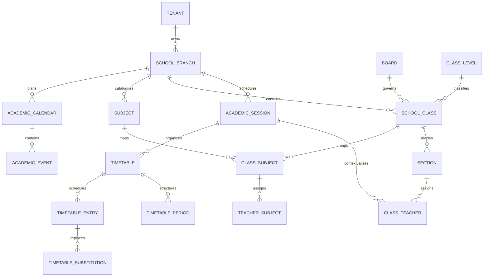

# Academic Management Module Architecture & Implementation Guide

## 1. Overview & Design Philosophy

EduCore School ERP SaaS features an enterprise-grade, highly configurable **Academic Management System** designed to support diverse educational boards—including **CBSE**, **ICSE**, **State Boards** (e.g., Maharashtra, Karnataka, Tamil Nadu, Uttar Pradesh), **Cambridge International (CAIE/IGCSE)**, and **International Baccalaureate (IB)**—without hardcoding board-specific rules or assessment logic into the core codebase.

### Core Architectural Principles
1. **Board-Agnostic Extensibility**:
   - Academic hierarchies, grading schemes, evaluation components, and subject classifications are defined dynamically via relational configurations rather than rigid code branches.
   - Multiple education boards can coexist within a single tenant (e.g., a school offering CBSE for Primary/Secondary and Cambridge for Senior Secondary).
2. **Strict Multi-Tenant & Branch Scoping**:
   - Every academic entity (`AcademicSession`, `SchoolClass`, `Section`, `Subject`, `AcademicCalendar`, `Timetable`, `TimetableEntry`) is strictly scoped by `tenant_id` and `school_branch_id`.
   - Cross-branch and cross-tenant leakage is prevented via Eloquent global query scopes, composite uniqueness constraints, and explicit authorization policies.
3. **Deterministic Constraint & Conflict Prevention**:
   - Overlapping academic session windows are blocked at the service level within the same school branch.
   - The Timetable Engine executes deterministic multi-resource conflict detection (Teacher, Room, Section, and Break period collisions) both preflight and on persistence.
4. **Historical Continuity & Immutability**:
   - Activating a new academic session atomically concludes the previous active session while preserving all historical enrollment, attendance, examination, and timetable records.

---

## 2. Database Domain & Relational Schema

The Academic Management domain is normalized across 18 specialized tables, utilizing UUID primary keys, foreign key constraints with cascade/restrict rules, and branch-level indexing.



### 2.1 Entity Relationship Summary

| Model / Table | Primary Key | Key Relationships & Foreign Keys | Uniqueness / Business Constraints |
| :--- | :--- | :--- | :--- |
| `Board` / `boards` | UUID | Optional `tenant_id` (system-wide standard boards have `tenant_id = NULL`) | Unique `code` per tenant |
| `AcademicSession` / `academic_sessions` | UUID | `tenant_id`, `school_branch_id` | Unique `(tenant_id, school_branch_id, code)` |
| `SchoolClass` / `classes` | UUID | `tenant_id`, `school_branch_id`, `board_id`, `class_level_id` | Unique `(tenant_id, school_branch_id, name)` & `(tenant_id, school_branch_id, code)` |
| `Section` / `sections` | UUID | `tenant_id`, `school_branch_id`, `class_id`, `room_id` | Unique `(class_id, name)` |
| `ClassTeacher` / `class_teachers` | UUID | `tenant_id`, `school_branch_id`, `academic_session_id`, `class_id`, `section_id`, `teacher_id` | Unique `(academic_session_id, section_id, is_primary = true)` |
| `Subject` / `subjects` | UUID | `tenant_id`, `school_branch_id`, `department_id` | Unique `(tenant_id, school_branch_id, code)` |
| `ClassSubject` / `class_subjects` | UUID | `tenant_id`, `school_branch_id`, `class_id`, `subject_id`, `academic_session_id` | Unique `(academic_session_id, class_id, subject_id)` |
| `TeacherSubject` / `teacher_subjects` | UUID | `tenant_id`, `school_branch_id`, `class_subject_id`, `teacher_id` | Unique `(class_subject_id, teacher_id)` |
| `AcademicCalendar` / `academic_calendars` | UUID | `tenant_id`, `school_branch_id`, `academic_session_id` | One primary calendar per session |
| `AcademicEvent` / `academic_events` | UUID | `tenant_id`, `school_branch_id`, `academic_calendar_id` | Validated `start_date <= end_date` |
| `Timetable` / `timetables` | UUID | `tenant_id`, `school_branch_id`, `academic_session_id`, `class_id`, `section_id` | One active timetable per section & session |
| `TimetablePeriod` / `timetable_periods` | UUID | `tenant_id`, `school_branch_id`, `timetable_id` | Ordered by `period_order`, `start_time < end_time` |
| `TimetableEntry` / `timetable_entries` | UUID | `tenant_id`, `school_branch_id`, `timetable_id`, `period_id`, `subject_id`, `teacher_id`, `room_id` | Unique `(timetable_id, period_id, day_of_week)` |
| `TimetableSubstitution` / `timetable_substitutions`| UUID | `tenant_id`, `school_branch_id`, `timetable_entry_id`, `original_teacher_id`, `substitute_teacher_id` | Substitute availability verified |

---

## 3. Academic Sessions Architecture

An Academic Session represents the official administrative and pedagogical school year (e.g., `2026-2027`).

### 3.1 Lifecycle States
- **`planning`**: Session created, classes, sections, and curricula configured; historical transactions still link to active session.
- **`active`**: Official current working session for admissions, attendance, timetabling, and examinations.
- **`completed`**: Academic year finished, final report cards issued, promotions executed.
- **`archived`**: Read-only historical session.

### 3.2 Overlap Prevention Algorithm
In `App\Services\Academic\AcademicSessionService::createSession()`:
```php
$overlapQuery = AcademicSession::where('school_branch_id', $branchId)
    ->where(function ($query) use ($startDate, $endDate) {
        $query->whereBetween('start_date', [$startDate, $endDate])
            ->orWhereBetween('end_date', [$startDate, $endDate])
            ->orWhere(function ($q) use ($startDate, $endDate) {
                $q->where('start_date', '<=', $startDate)
                  ->where('end_date', '>=', $endDate);
            });
    });

if ($overlapQuery->exists()) {
    throw new InvalidArgumentException(
        "Academic session dates overlap with an existing session in this school branch."
    );
}
```

### 3.3 Atomic Session Activation
Activating an academic session uses an atomic database transaction (`DB::transaction`) to guarantee zero downtime and prevent dual-active states:
1. Deactivates any currently active session in the branch:
   ```php
   AcademicSession::where('school_branch_id', $branchId)
       ->where('is_active', true)
       ->update(['is_active' => false, 'status' => 'completed']);
   ```
2. Activates the requested session:
   ```php
   $session->update(['is_active' => true, 'status' => 'active']);
   ```

---

## 4. Class & Section Management

The class hierarchy supports K-12, pre-school, and higher secondary structures with distinct division mechanisms:

### 4.1 Class Ordering and Progression
- Each class holds an `order_index` integer (e.g., Nursery = 0, Grade 1 = 1, Grade 12 = 12) used by student promotion algorithms to advance batches sequentially.
- Classes are linked to educational boards (`Board`) and standardized class levels (`ClassLevel`: Primary, Middle, Secondary, Senior Secondary).

### 4.2 Section & Class Teacher Allocations
- **Sections** (e.g., `A`, `B`, `C` or `Emerald`, `Ruby`) enforce physical room assignment and a `capacity` limit.
- **Class Teachers**:
  - Allocated on a per-session, per-section basis via the `ClassTeacher` model.
  - Supports Primary Class Teacher (`is_primary = true`) and Assistant Class Teachers (`is_primary = false`).
  - When assigning a new primary class teacher, existing primary assignments for that section/session are automatically demoted to avoid dual-primary conflicts.

---

## 5. Subject Catalogue & Grouping

Subjects support comprehensive categorization catering to theoretical, vocational, and co-curricular programs:

### 5.1 Subject Attributes
- `code`: Unique identifier per branch (e.g., `MATH101`, `PHY-CBSE-11`).
- `type`: `theory`, `practical`, `both`, `elective`, `vocational`.
- `credit_hours`: Pedagogical weight for GPA/CGPA calculations.
- `passing_marks` and `total_marks`: Baselines for grading systems.
- `is_elective`: Determines whether all students in the class must take it or if individual student subject election is required.

### 5.2 Mapping & Teacher Assignment
- **`ClassSubject`**: Links a subject to a class for a specific academic session. Sets weekly lecture quotas and order index on report cards.
- **`TeacherSubject`**: Links qualified faculty (`Employee`) to specific class subjects, enabling workload tracking and conflict detection.

---

## 6. Academic Calendar & Events

The Academic Calendar manages official scheduling milestones for students, faculty, and administrative staff:

### 6.1 Event Categorization
- `holiday`: Mandatory non-working days (national holidays, religious festivals).
- `working_day`: Special working days (e.g., Saturday compensation).
- `examination`: Mid-term, unit test, practical, and annual examination windows.
- `vacation`: Extended breaks (Summer break, Winter recess, Diwali holidays).
- `event`: Sports day, cultural festivals, parent-teacher meetings, annual day.

### 6.2 Audience Scoping
Events can be scoped to:
- `all`: Whole school community.
- `students`: Student-only activities.
- `staff`: Faculty development programs, administrative training.
- `parents`: PTMs and orientation sessions.

---

## 7. Master Timetable Engine & Conflict Detection

The Timetable Engine coordinates periods, teachers, subjects, and rooms across weekly school schedules (Monday through Saturday) with zero tolerance for resource double-booking.

### 7.1 Multi-Resource Conflict Matrix

The conflict detection engine (`App\Services\Academic\TimetableService::detectSlotConflicts`) checks 4 distinct collision vectors before allowing an entry to be created or modified:

```
+-------------------------------------------------------------------------------+
|                       SLOT ASSIGNMENT REQUEST                                  |
| (Timetable, Day, Period, Subject, Teacher, Room)                              |
+-------------------------------------------------------------------------------+
                                      |
         +----------------------------+----------------------------+
         |                            |                            |
         v                            v                            v
[1. Break Period Check]     [2. Teacher Conflict]        [3. Room Conflict]
Is Period a Break/Recess?   Is Teacher booked in another  Is Room booked by another
  -> REJECT                   class at the same time?      class at the same time?
                               -> REJECT                    -> REJECT
                                      |
                                      v
                             [4. Section Collision]
                             Does Section already have an
                             assigned subject in this period?
                               -> REJECT
                                      |
                                      v
                               [VALIDATION PASS]
                            Persist TimetableEntry
```

#### Detailed Conflict Rules:
1. **Break Period Collision (`BREAK_CONFLICT`)**:
   - Academic subjects cannot be scheduled during a period flagged as `is_break = true` (e.g., Morning Assembly, Lunch Break, Recess).
2. **Teacher Double-Booking (`TEACHER_CONFLICT`)**:
   - Queries `timetable_entries` joined with `timetable_periods` across the entire branch.
   - If the teacher is already assigned to any other section on the same day during overlapping time slots, the operation is blocked with details of the conflicting class.
   - Also cross-checks active **Substitutions** (`timetable_substitutions`).
3. **Room Double-Booking (`ROOM_CONFLICT`)**:
   - Verifies whether the specified room (`rooms` table) is already occupied by another class/section during the same day and time slot.
4. **Section Slot Collision (`SECTION_CONFLICT`)**:
   - Prevents duplicate subject assignments for the same section during the same period and day.

### 7.2 Substitute Teacher Engine
When a faculty member is on leave or unavailable, the system allocates a substitute:
- **Preflight Conflict Verification**: Validates that the substitute teacher does not already have a scheduled lecture or existing substitution during that exact period and day.
- **Workflow State**: Transitions through `pending` -> `approved` -> `completed` (or `cancelled`).
- **Audit Logging**: Retains full traceability of the original teacher, substitute teacher, requesting administrator, and operational notes.

---

## 8. REST API Reference

All Academic Management endpoints are registered under `/api/v1/academic` and guarded by `auth:sanctum`, `tenant.context`, and Spatie permission middleware.

### 8.1 Academic Sessions
- `GET /api/v1/academic/sessions` - List all sessions for the active branch (includes metrics).
- `POST /api/v1/academic/sessions` - Create a new session. `[permission:academic.manage]`
  - Body: `{ name, code, start_date, end_date, is_active }`
- `GET /api/v1/academic/sessions/{id}` - Retrieve detailed session info with class counts.
- `POST /api/v1/academic/sessions/{id}/activate` - Atomically activate session. `[permission:academic.manage]`

### 8.2 Boards & Class Levels
- `GET /api/v1/academic/boards` - List education boards (CBSE, ICSE, State Boards, etc.).
- `GET /api/v1/academic/boards/classes` - Grouped hierarchy of classes by board.

### 8.3 Classes & Sections
- `GET /api/v1/academic/classes` - List all classes with sections and teacher assignments.
- `POST /api/v1/academic/classes` - Create a class. `[permission:classes.create]`
  - Body: `{ name, code, board_id, class_level_id, order_index, description }`
- `PUT /api/v1/academic/classes/{id}` - Update class metadata. `[permission:classes.edit]`
- `POST /api/v1/academic/classes/{id}/sections` - Create a section for a class. `[permission:classes.create]`
  - Body: `{ name, room_id, capacity }`
- `POST /api/v1/academic/classes/{id}/sections/{sectionId}/teachers` - Assign class teacher. `[permission:classes.edit]`
  - Body: `{ teacher_id, academic_session_id, is_primary }`

### 8.4 Subject Catalogue
- `GET /api/v1/academic/subjects` - List subjects catalogue.
- `POST /api/v1/academic/subjects` - Add new subject. `[permission:subjects.manage]`
  - Body: `{ name, code, type, credit_hours, total_marks, passing_marks, is_elective }`
- `POST /api/v1/academic/subjects/map-class` - Map subject to class. `[permission:subjects.manage]`
  - Body: `{ class_id, subject_id, academic_session_id, weekly_periods }`
- `POST /api/v1/academic/subjects/assign-teacher` - Assign teacher to subject. `[permission:subjects.manage]`
  - Body: `{ class_subject_id, teacher_id }`

### 8.5 Academic Calendar
- `GET /api/v1/academic/calendar` - Retrieve calendar events, holidays, and summary stats.
- `POST /api/v1/academic/calendar/events` - Add event or holiday. `[permission:calendar.manage]`
  - Body: `{ academic_calendar_id, title, event_type, start_date, end_date, audience, is_holiday }`

### 8.6 Timetable Engine
- `GET /api/v1/academic/timetables` - Get timetable schedule matrix for section & session.
- `POST /api/v1/academic/timetables` - Create or update timetable periods/structure. `[permission:timetable.manage]`
- `POST /api/v1/academic/timetables/slots` - Assign subject/teacher/room to slot with conflict detection. `[permission:timetable.manage]`
  - Body: `{ timetable_id, period_id, day_of_week, subject_id, teacher_id, room_id }`
- `POST /api/v1/academic/timetables/substitutions` - Assign substitute teacher with availability validation. `[permission:timetable.manage]`
  - Body: `{ timetable_entry_id, date, substitute_teacher_id, reason }`

---

## 9. Next.js Frontend Interface

The frontend is implemented in Next.js 16 App Router at `src/app/academic/page.tsx` with a rich, interactive tabbed dashboard:

1. **Overview & Board Architecture**:
   - Visual cards for CBSE, ICSE, State Boards, Cambridge, and IB.
   - Highlights the board-agnostic assessment principles.
2. **Academic Sessions**:
   - Table of all historical and active academic sessions.
   - Status indicators (`active`, `planning`, `completed`).
   - "Activate Session" action with real-time state synchronization.
   - New session creation modal with date range pickers.
3. **Classes & Sections**:
   - Grid layout of grades/classes with ordered badges.
   - Displays section room capacities, assigned class teachers, and student metrics.
   - Modals to create new classes and add sections.
4. **Subject Catalogue**:
   - Comprehensive searchable subject table.
   - Badges for Subject Type (`Theory`, `Practical`, `Elective`, `Vocational`) and credit hours.
   - Modal to define new subjects.
5. **Academic Calendar**:
   - Events and holidays grid organized by upcoming dates.
   - Category tags (`holiday`, `vacation`, `examination`, `event`).
   - Modal to schedule new calendar events.
6. **Master Timetable Matrix**:
   - Interactive weekly matrix (Monday through Saturday) across all configured periods.
   - Color-coded badges for break periods, subject tags, teacher names, and room numbers.
   - **Preflight Conflict Detection**: Real-time pre-check modal alerting administrators before persisting double-bookings.
   - **Substitute Teacher Modal**: Allows one-click assignment of substitutes with immediate conflict feedback.

---

## 10. Automated Test Suite & Verification

The Academic Management module is backed by a 100% green feature test suite in `backend/tests/Feature/AcademicManagementTest.php`.

### Test Coverage Matrix:
- `✓ academic session service creates session and validates dates`
- `✓ cannot create overlapping academic session within the same branch`
- `✓ can activate academic session and atomically close previous session`
- `✓ class management creates classes and prevents duplicate class name or code in branch`
- `✓ section management creates sections and prevents duplicate section names within a class`
- `✓ can assign class teacher to a section for an academic session`
- `✓ subject management creates subjects, maps to classes and assigns teachers`
- `✓ academic calendar creates events and computes holidays`
- `✓ timetable conflict detection catches teacher, room, section, and break conflicts`
- `✓ substitute teacher assignment validates conflicts`
- `✓ HTTP API routes for academic management enforce permissions and tenancy`

**Full Suite Status**: **44 passed, 369 assertions green**, 0 regressions.

