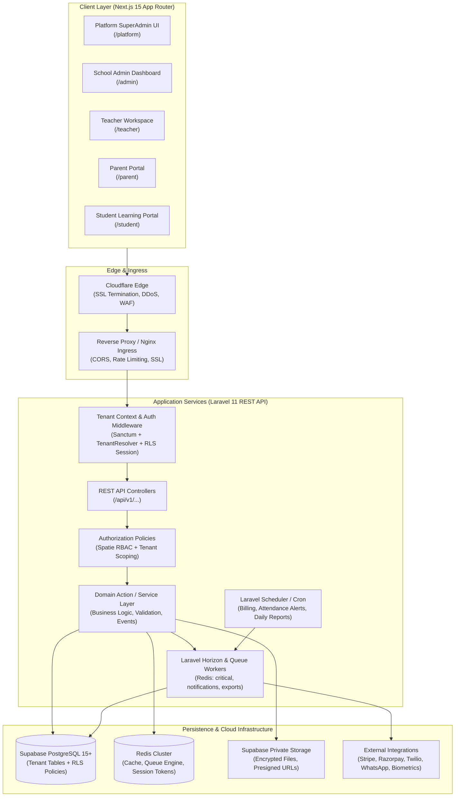
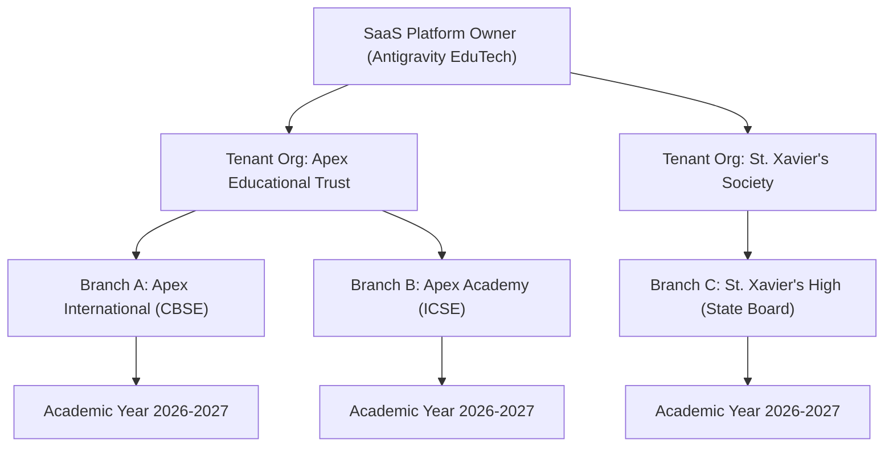
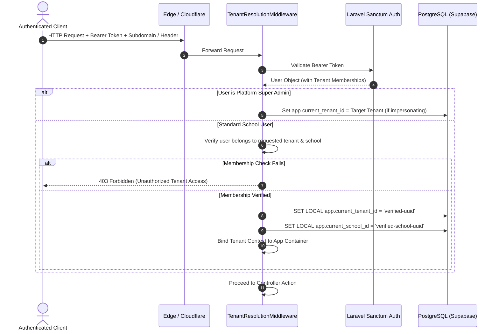
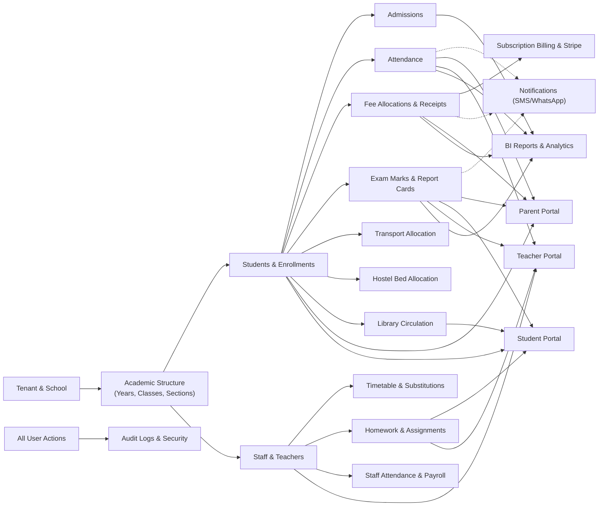

# System Architecture Document
## Project: Multi-Tenant School Management System (School ERP SaaS)
**Document Version:** 1.0.0  
**Architect:** Senior SaaS Product Architect & Technical Lead  

---

## 1. High-Level Architecture Overview

The platform uses a decoupled client-server architecture:
- **Frontend Presentation Tier:** Next.js 15 with App Router, TypeScript, Tailwind CSS, and shadcn/ui.
- **Backend API & Business Logic Tier:** Laravel 11 REST API, PHP 8.2+, Laravel Sanctum, and Spatie Laravel Permission.
- **Data Persistence & Storage Tier:** Supabase PostgreSQL with Row Level Security (RLS) and Supabase Storage for encrypted object storage.
- **Asynchronous Execution & Caching Tier:** Redis (via Predis/PhpRedis) powering Laravel Queues, Cache, and Scheduler.

---

## 2. Multi-Tenancy Architecture

### 2.1 Multi-Tenancy Paradigm: Shared Database with Discriminator Column & RLS
We employ a **Shared Database, Shared Schema** architecture utilizing compound tenant discriminator columns (`tenant_id`, `school_id`), reinforced by **PostgreSQL Row-Level Security (RLS)** as a defense-in-depth security layer.

#### Why Shared Schema with Discriminator Column?
1. **Operational Agility:** Schema migrations are executed once across the platform rather than thousands of times across separate databases or schemas.
2. **Resource Efficiency:** Avoids connection pool exhaustion on PostgreSQL, optimizing Supabase compute overhead.
3. **Cross-Branch Operations:** School organizations with multiple branches (`schools`) under a single corporate parent (`tenant`) can seamlessly execute consolidated group-wide reporting without federated database queries.
4. **Defense in Depth:** Dual protection:
   - **Layer 1 (Application):** Eloquent Global Scopes enforce `where('tenant_id', ...)` on every database query.
   - **Layer 2 (Database Engine):** PostgreSQL Row Level Security enforces tenant isolation even in raw queries, database seeds, or rogue developer scripts.

### 2.2 Hierarchical Tenancy Model

- **`tenants` Table:** Represents the legal billing entity (e.g., trust, corporate entity, school chain).
- **`schools` Table:** Represents physical school campuses / branches belonging to a tenant.
- **Discriminators on Entity Tables:**
  - `tenant_id` (UUID): Mandated on **all** business tables.
  - `school_id` (UUID): Mandated on campus-specific tables (e.g., classrooms, timetables, local fees, inventory).

### 2.3 Tenant Resolution & Anti-Spoofing Pipeline

#### Anti-Spoofing Rule
The frontend NEVER determines tenancy through unverified query params or headers. Even if `X-Tenant-ID` is passed, the `TenantResolutionMiddleware`:
1. Authenticates the user via Sanctum.
2. Checks the user's explicit relation in `tenant_users`.
3. Validates that the requested `school_id` belongs to the verified `tenant_id`.
4. Rejects any mismatch with `403 Forbidden` and logs a security alert.

---

## 3. Module Dependency & Architecture Relationships

### 3.1 Layered Module Dependency Diagram
Modules are organized into 5 architectural tiers, where each tier depends only on lower tiers:

```mermaid
graph TD
    subgraph Tier0["Tier 0: Infrastructure & Security Foundation"]
        M1["01. SaaS Platform Admin"]
        M2["02. Tenant & School Mgmt"]
        M3["03. Subscription & Billing"]
        M5["05. Auth & User Mgmt"]
        M6["06. RBAC & Permissions"]
        M30["30. Audit Logs & Security"]
    end

    subgraph Tier1["Tier 1: Core Academic & People Foundation"]
        M4["04. School Onboarding"]
        M7["07. Academic Management"]
        M8["08. Student Management"]
        M10["10. Parent & Guardian Mgmt"]
        M11["11. Teacher & Staff Mgmt"]
    end

    subgraph Tier2["Tier 2: Operational Engine"]
        M9["09. Admission Management"]
        M12["12. Attendance Management"]
        M13["13. Fee & Financial Mgmt"]
        M14["14. Exam & Result Mgmt"]
        M15["15. Timetable Management"]
        M16["16. Homework & Assignment"]
        M25["25. Communication & Notifs"]
    end

    subgraph Tier3["Tier 3: Specialized Auxiliary Modules"]
        M20["20. Library Management"]
        M21["21. Transport Management"]
        M22["22. Inventory Management"]
        M23["23. Payroll and HR"]
        M24["24. Hostel Management"]
        M26["26. Certificate Generation"]
        M27["27. Visitor & Gate Pass"]
    end

    subgraph Tier4["Tier 4: Experience, Portals & Intelligence"]
        M17["17. Parent Portal"]
        M18["18. Student Portal"]
        M19["19. Teacher Portal"]
        M28["28. Reports & Analytics"]
        M29["29. Helpdesk & Complaints"]
    end

    %% Dependencies
    Tier1 --> Tier0
    Tier2 --> Tier1
    Tier3 --> Tier2
    Tier4 --> Tier3
    Tier4 --> Tier2
    Tier4 --> Tier1
```

### 3.2 Detailed Inter-Module Entity Relationship Flow

---

## 4. Technology Stack Specification

### 4.1 Frontend Architecture
- **Framework:** Next.js 15 (React 19) utilizing App Router.
- **Routing Organization:**
  - `(auth)`: Login, 2FA, password recovery, invite acceptance.
  - `(platform)`: SaaS SuperAdmin control plane.
  - `(school)`: Multi-branch school administrative workspace.
  - `(portal)`: Sub-routes for `(parent)`, `(student)`, and `(teacher)` tailored views.
- **State Management & Data Fetching:**
  - Server Components for direct server rendering and SEO where applicable.
  - TanStack Query (React Query) v5 for optimistic updates, polling, and cache invalidation in Client Components.
- **Form Architecture:** React Hook Form bound with Zod schemas matching backend API validation rules.
- **Design System:** Tailwind CSS with shadcn/ui (Radix UI primitives), Lucide React icons, and Recharts for interactive financial/academic telemetry.

### 4.2 Backend Architecture
- **Framework:** Laravel 11 running on PHP 8.2+.
- **Design Pattern:** Action-Domain-Responder (ADR) or Service-Repository hybrid:
  - `FormRequest`: Strict HTTP payload validation.
  - `Policies`: Authorization guards verifying permissions and tenant ownership.
  - `Actions`: Pure, testable single-responsibility classes executing business logic.
  - `Resources`: API JSON response transformation formatting.
- **Multi-Tenancy Driver:** Custom Tenancy Kernel utilizing Eloquent Global Scopes and Database Session variables (`SET LOCAL app.current_tenant_id`).
- **Testing Engine:** Pest v3 with comprehensive Feature and Unit test suites enforcing code coverage requirements.

### 4.3 Database & Storage Architecture
- **Database:** Supabase PostgreSQL 15+ hosted on managed cloud infrastructure.
  - Database Extensions: `uuid-ossp`, `pgcrypto`, `btree_gist`, `pg_trgm`.
  - Row Level Security (RLS) enabled on all tenant-facing tables.
- **Object Storage:** Supabase Storage configured with private S3-compatible buckets:
  - `tenant-assets-public`: Public school logos, favicon, report card banners.
  - `student-documents-private`: Encrypted birth certificates, IDs, health records.
  - `staff-documents-private`: Employment contracts, salary slips, resumes.
  - Access controlled via pre-signed URLs with a 15-minute TTL.

### 4.4 Caching, Queues & Scheduling
- **Message Broker:** Redis Cluster.
- **Queue Queuing Priorities:**
  - `critical`: Payment webhook processing, two-factor authentication tokens.
  - `notifications`: WhatsApp messages, SMS alerts, transactional emails.
  - `reports`: Batch PDF generation (report cards, salary slips, fee receipts).
  - `default`: General asynchronous operations (audit logging, file processing).
- **Scheduled Tasks (Laravel Scheduler):**
  - Daily 00:00: Automatic fee overdue penalty computation.
  - Daily 08:30: Absentee notification batch dispatch.
  - Hourly: Subscription expiration checks and dunning email triggers.

---

## 5. Security & Threat Mitigation Architecture

1. **Cross-Tenant Data Bleed Prevention:**
   - Eloquent Global Scope `TenantScope` automatically appends `WHERE tenant_id = ?` to all model queries.
   - PostgreSQL RLS enforces `tenant_id = NULLIF(current_setting('app.current_tenant_id', true), '')::uuid` at the database engine level.
2. **Horizontal Privilege Escalation Prevention:**
   - Every route parameter (e.g., `/api/v1/students/{student}`) is validated through Laravel Policies: `$user->tenant_id === $student->tenant_id && $user->can('view', $student)`.
3. **Session & Token Defense:**
   - Laravel Sanctum tokens are hashed in storage (`SHA-256`).
   - Token claims carry `tenant_id` and authorized `school_id`.
   - Token revocation hooks trigger immediately on password change, role demotion, or tenant suspension.
4. **Audit Trail Integrity:**
   - Audit logs are written asynchronously via database transactions to an immutable `audit_logs` table with non-updatable database triggers.

