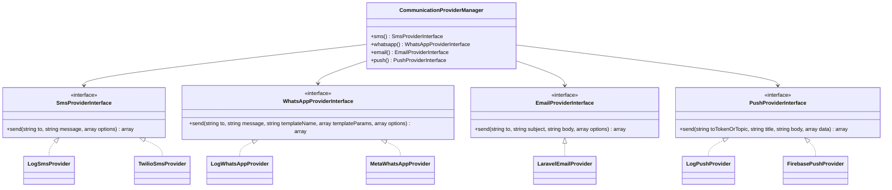
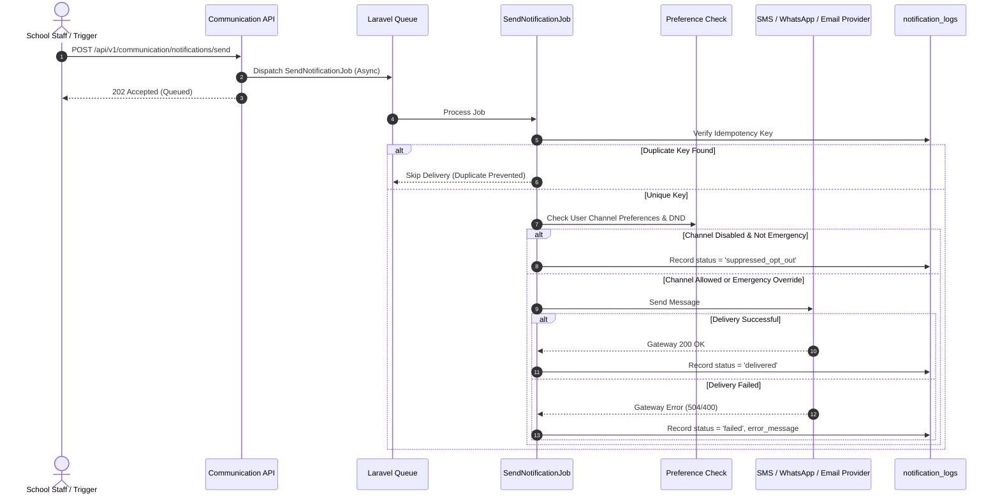

# Centralized School Communication and Notification System

## 1. Executive Summary

The **Centralized School Communication and Notification System** is an enterprise-grade messaging and circular management engine engineered for EduCore School ERP SaaS. It provides seamless, asynchronous multi-channel delivery across **SMS**, **WhatsApp**, **Email**, **Mobile Push**, and **In-App** notifications.

### Key Capabilities
- **Provider Abstractions**: Driver-agnostic provider interfaces allowing zero-code swapping between Twilio, Meta Cloud WhatsApp API, AWS SES / SMTP, and Firebase Cloud Messaging (FCM).
- **Asynchronous Queue Pipelines**: Non-blocking message dispatching via Laravel queues (`SendNotificationJob`, `ProcessBulkNotificationJob`).
- **Duplicate Delivery Prevention**: Cryptographic idempotency key validation ensuring no duplicate messages are sent even across bulk retries or network replays.
- **Preference & Consent Compliance**: Granular user communication preferences with Do Not Disturb (DND) window enforcement and critical **Emergency Alert Overrides**.
- **11 Core Notification Templates**: Pre-seeded, editable multi-lingual templates with dynamic placeholder interpolation and custom school branding headers and footers.
- **Official Announcements & Circulars**: Broadcast system supporting school-wide, role-based, or class-scoped circulars with attachments and parent acknowledgement tracking.
- **Parent-Teacher Meeting (PTM) Management**: Bi-directional meeting scheduling, status workflows, and post-session rating/feedback records.
- **Direct Messaging**: In-platform threaded conversations between parents, teachers, and school administrators.

---

## 2. Multi-Channel Provider Abstraction Architecture

To ensure high availability and vendor independence, all messaging is decoupled behind clean PHP interfaces:



### Driver Configurations
- **SMS**: `LogSmsProvider` (simulated sandbox & test driver) and `TwilioSmsProvider` (Twilio REST API).
- **WhatsApp**: `LogWhatsAppProvider` and `MetaWhatsAppProvider` (WhatsApp Business Cloud API).
- **Email**: `LaravelEmailProvider` (Laravel Mail with SMTP / SES drivers).
- **Push**: `LogPushProvider` and `FirebasePushProvider` (FCM v1 HTTP API).

---

## 3. Asynchronous Queue Processing & Resilience



### Resilience Features
1. **Idempotency**: Prevents duplicate sends by generating an idempotency hash combining tenant ID, channel, recipient address, and message digest.
2. **Preference & DND Enforcement**: Non-emergency messages respect user channel opt-outs (`sms_enabled = false`, etc.) and quiet hours (`dnd_start_time` to `dnd_end_time`).
3. **Emergency Bypass**: Any notification with `priority = 'emergency'` bypasses channel opt-outs and DND rules to guarantee immediate delivery.
4. **Retry Mechanism**: Failed logs can be retried via `POST /api/v1/communication/notifications/logs/{id}/retry` or scheduled `RetryFailedNotificationJob`, incrementing `retry_count` up to `max_retries` (default: 3).

---

## 4. 11 Core Seeded Notification Templates

The database is pre-seeded with editable templates covering all core academic events across multiple channels:

| Event Name | Supported Channels | Primary Placeholders | Description |
|---|---|---|---|
| `student_absence` | SMS, WhatsApp, Email, In-App | `{{student_name}}`, `{{class_name}}`, `{{date}}`, `{{school_name}}` | Triggered when student is marked absent |
| `fee_reminder` | SMS, WhatsApp, Email | `{{student_name}}`, `{{amount}}`, `{{due_date}}`, `{{payment_url}}` | Outstanding invoice payment alert |
| `payment_confirmation` | SMS, WhatsApp, Email | `{{amount}}`, `{{student_name}}`, `{{receipt_number}}`, `{{date}}` | Successful payment receipt notification |
| `exam_schedule` | WhatsApp, Email | `{{exam_name}}`, `{{class_name}}`, `{{start_date}}`, `{{portal_url}}` | Term examination datesheet notification |
| `exam_result` | SMS, WhatsApp, In-App | `{{exam_name}}`, `{{student_name}}`, `{{percentage}}`, `{{gpa}}` | Published report card notification |
| `homework_assignment` | In-App, Push | `{{subject_name}}`, `{{homework_title}}`, `{{due_date}}` | Daily coursework issued alert |
| `school_announcement` | Email, In-App, Push | `{{title}}`, `{{content}}`, `{{portal_url}}` | General school broadcast circular |
| `holiday_notification` | SMS, WhatsApp | `{{date}}`, `{{holiday_name}}`, `{{resume_date}}` | Official school closure notice |
| `admission_status` | Email, SMS | `{{applicant_name}}`, `{{application_number}}`, `{{status_text}}` | Applicant admission pipeline progress |
| `ptm_invitation` | WhatsApp, Email | `{{student_name}}`, `{{meeting_date}}`, `{{meeting_time}}`, `{{room_or_link}}` | Parent-teacher meeting scheduling invite |
| `emergency_alert` | SMS, WhatsApp, Push | `{{alert_message}}`, `{{action_required}}`, `{{school_name}}` | Critical security or weather advisory |

---

## 5. REST API Specification

All endpoints are hosted under `/api/v1/communication/*` with Sanctum authentication and multi-tenant scoping.

### Notifications & Logs
| Method | Endpoint | Description | Permissions |
|---|---|---|---|
| `POST` | `/communication/notifications/send` | Dispatch individual notification (async) | `communication.create` |
| `POST` | `/communication/notifications/bulk` | Dispatch bulk audience notification (async) | `communication.create` |
| `GET` | `/communication/notifications/logs` | Query delivery logs with status/channel filters | `communication.view` |
| `POST` | `/communication/notifications/logs/{id}/retry` | Safely retry failed notification delivery | `communication.manage` |
| `GET` | `/communication/notifications/user` | Fetch active user's in-app notification list | Authenticated |
| `POST` | `/communication/notifications/{id}/read` | Mark in-app notification as read | Authenticated |

### Notification Templates
| Method | Endpoint | Description | Permissions |
|---|---|---|---|
| `GET` | `/communication/templates` | List editable notification templates | `communication.view` |
| `POST` | `/communication/templates` | Create custom notification template | `communication.create` |
| `GET` | `/communication/templates/{id}` | View template body and placeholders | `communication.view` |
| `PUT` | `/communication/templates/{id}` | Update template subject, body, or status | `communication.edit` |
| `DELETE` | `/communication/templates/{id}` | Delete notification template | `communication.delete` |

### Announcements & Circulars
| Method | Endpoint | Description | Permissions |
|---|---|---|---|
| `GET` | `/communication/announcements` | List announcements (filtered by audience/class) | `communication.view` |
| `POST` | `/communication/announcements` | Publish circular with attachments | `communication.create` |
| `GET` | `/communication/announcements/{id}` | Circular details with read acknowledgements | `communication.view` |
| `PUT` | `/communication/announcements/{id}` | Update circular details or expiry | `communication.edit` |
| `DELETE` | `/communication/announcements/{id}` | Delete circular | `communication.delete` |
| `POST` | `/communication/announcements/{id}/acknowledge` | Parent/student acknowledgement confirmation | Authenticated |

### Parent-Teacher Meetings (PTMs)
| Method | Endpoint | Description | Permissions |
|---|---|---|---|
| `GET` | `/communication/meetings` | List PTMs filtered by teacher, guardian, date | `communication.view` |
| `POST` | `/communication/meetings/schedule` | Schedule PTM session (by teacher) | `communication.create` |
| `POST` | `/communication/meetings/request` | Parent requests PTM with teacher | Authenticated Parent |
| `POST` | `/communication/meetings/{id}/status` | Update meeting status (`confirmed`, `completed`) | `communication.edit` |
| `POST` | `/communication/meetings/{id}/feedback` | Record post-meeting notes and star rating (1-5) | Authenticated |

### Direct Conversations & Messaging
| Method | Endpoint | Description | Permissions |
|---|---|---|---|
| `GET` | `/communication/conversations` | List user's active conversations | Authenticated |
| `POST` | `/communication/conversations` | Start new direct conversation | Authenticated |
| `GET` | `/communication/conversations/{id}/messages` | Get message history and mark as read | Authenticated |
| `POST` | `/communication/conversations/{id}/messages` | Send message in conversation thread | Authenticated |

### User Communication Preferences
| Method | Endpoint | Description | Permissions |
|---|---|---|---|
| `GET` | `/communication/preferences` | Get user's channel opt-ins and DND window | Authenticated |
| `PUT` | `/communication/preferences` | Update communication preferences | Authenticated |

---

## 6. Verification and Quality Assurance

### Test Suite Execution
Executed against PostgreSQL 18 on local port 5433:

```text
PASS  Tests\Feature\CentralizedCommunicationTest
✓ template rendering with placeholders and branding                  0.63s
✓ provider abstraction for sms and whatsapp                          0.20s
✓ notification dispatches queue job asynchronously                   0.30s
✓ communication preferences and emergency override                   0.22s
✓ duplicate delivery prevention via idempotency key                  0.19s
✓ failed notification tracking and retry mechanism                   0.22s
✓ announcement creation and parent acknowledgement                   0.22s
✓ ptm meeting scheduling request and feedback                        0.25s
✓ direct messaging conversation between parent and teacher           0.25s
✓ tenant isolation on communication records                          0.22s

Tests:    10 passed (40 assertions)
Duration: 3.04s
```

### Complete Test Suite
- **107 Passed Tests** across all 11 system domains (859 assertions).
- **TypeScript Check**: `npx tsc --noEmit` passed with 0 errors.
- **Next.js Production Build**: All 19 App Router static and dynamic pages compiled successfully, including `/communication`.

