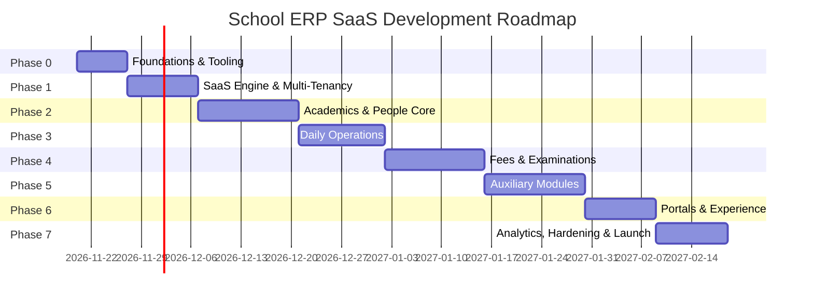

# Development Roadmap & Execution Plan
## Project: Multi-Tenant School Management System (School ERP SaaS)
**Document Version:** 1.0.0  
**Methodology:** Iterative Agile / Sprint-Driven Architecture  
**Quality Gate:** 100% Automated Testing Gate per Milestone  

---

## 1. Roadmap Overview & Timeline

The platform will be delivered across 8 clearly bounded, sequential phases (Phase 0 through Phase 7). Each phase is delivered with complete unit/feature test coverage, database migrations, seeders, API endpoints, and corresponding frontend interfaces before proceeding to the subsequent phase.

---

## 2. Phase-by-Phase Breakdown

### Phase 0: Project Foundations, Tooling & Infrastructure
**Goal:** Establish clean repository structure, development tooling, CI/CD pipeline, and database connectivity.
- **Backend Deliverables:**
  - Initialize Laravel 11 project with PHP 8.2+.
  - Configure Supabase PostgreSQL connection with UUID extension support.
  - Setup Redis for caching and queue engine.
  - Install and configure Pest PHP v3 with code coverage reporting.
  - Establish base API response traits and global exception handlers.
- **Frontend Deliverables:**
  - Initialize Next.js 15 (React 19) project with App Router and TypeScript.
  - Configure Tailwind CSS and initialize shadcn/ui component library.
  - Configure Axios/Fetch API client with automatic token attachment and refresh interceptors.
  - Setup Lucide React icons, Sonner toast notifications, and Dark Mode theme provider.
- **Quality Gates:** Zero lint errors (`phpstan` Level 8, `eslint`), passing baseline Pest test suite.

---

### Phase 1: Multi-Tenancy Core, Authentication & SaaS Platform
**Goal:** Implement true multi-tenant database isolation, Laravel Sanctum token auth, Spatie RBAC, and SaaS subscription billing.
- **Backend Deliverables:**
  - Create migrations for `tenants`, `schools`, `subscription_plans`, `subscriptions`, `users`, `tenant_users`.
  - Implement `TenantScope` Eloquent Global Scope and `TenantResolutionMiddleware`.
  - Configure PostgreSQL Row Level Security (RLS) policies on tenant tables.
  - Setup Spatie Laravel Permission with compound `(tenant_id, school_id)` support.
  - Implement authentication endpoints (`/auth/login`, `/auth/two-factor`, `/auth/switch-school`).
  - Implement Stripe & Razorpay webhook listeners for subscription provisioning.
- **Frontend Deliverables:**
  - Build Auth layout: Login, 2FA prompt, password recovery, invite acceptance.
  - Build Platform SuperAdmin control plane (`/platform`): Tenant management, plan builder, subscription metrics.
  - Build School Switcher component for multi-branch organizations.
- **Quality Gates:** 100% test coverage on Tenant Isolation (asserting user from Tenant A receives 403/404 when querying Tenant B).

---

### Phase 2: Academic Core & People Management
**Goal:** Enable institutions to configure their academic calendar, grade hierarchy, and manage students, guardians, and staff.
- **Backend Deliverables:**
  - Migrations: `academic_years`, `academic_terms`, `classes`, `sections`, `subjects`, `students`, `guardians`, `student_guardians`, `student_enrollments`, `staff`.
  - Student 360-degree profile API with document vault integration (Supabase Storage signed URLs).
  - Bulk student import pipeline via Excel/CSV with background queue validation.
  - Admission pipeline: Lead inquiry -> Application -> Entrance exam -> One-click enrollment.
- **Frontend Deliverables:**
  - School Admin Workspace: Academic Year configuration screen.
  - High-performance data table for Students with multi-column filtering, fuzzy search, and bulk export.
  - Student Profile modal & document viewer with secure signed URL access.
  - Admission CRM kanban board for tracking applicant stages.
- **Quality Gates:** Successful bulk import test with 1,000 student records under 5 seconds with validation errors flagged.

---

### Phase 3: Daily School Operations (Attendance, Timetable & Homework)
**Goal:** Deliver daily operational tools used continuously by teachers, students, and administrators.
- **Backend Deliverables:**
  - Migrations: `student_attendances`, `staff_attendances`, `timetable_slots`, `homework`, `homework_submissions`.
  - Fast bulk attendance recording API with daily summary aggregation.
  - Timetable scheduling conflict detector (validating teacher and room availability).
  - Homework creation and digital submission evaluation API.
  - Communication dispatcher for SMS, WhatsApp, and Email triggers on absence.
- **Frontend Deliverables:**
  - Rapid Attendance Grid with keyboard navigation for teachers (P/A/L hotkeys).
  - Visual Timetable Grid with drag-and-drop schedule editing and conflict warnings.
  - Homework assignment submission viewer with inline PDF/image preview.
- **Quality Gates:** Conflict validator unit tests covering 100% of double-booking edge cases.

---

### Phase 4: Financial Management & Examination Engine
**Goal:** Deploy financial revenue management, student fee invoicing, payment gateway collection, and board-agnostic grading.
- **Backend Deliverables:**
  - Migrations: `fee_groups`, `fee_types`, `fee_structures`, `fee_allocations`, `fee_transactions`, `grading_scales`, `exams`, `exam_schedules`, `exam_marks`.
  - Automated fee overdue fine calculation engine running via Laravel Scheduler.
  - Online payment checkout via Razorpay & Stripe with webhook payment verification.
  - Automated receipt PDF generation with unique receipt numbering.
  - Configurable report card generator supporting CBSE, ICSE, and GPA scales.
- **Frontend Deliverables:**
  - Financial Dashboard: Fee collection KPIs, outstanding dues by class, fee collection trends.
  - Cashier / Counter Fee Collection Screen with instant thermal and PDF receipt generation.
  - Tabular Gradebook entry matrix with auto-calculation of total scores and grades.
  - Report Card preview and batch download modal.
- **Quality Gates:** Financial ledger reconciliation tests (asserting total allocated = paid + discounts + outstanding to the exact cent).

---

### Phase 5: Specialized Operational Modules
**Goal:** Integrate logistics, facilities, security, and institutional assets into the centralized ERP.
- **Backend Deliverables:**
  - Library Management: Book accessioning, ISBN barcode checkout, overdue fine tracking.
  - Transport Management: Route, vehicle, stop allocation, and driver credential compliance.
  - Inventory & Assets: Vendor purchase orders, stock ledger, departmental requisitions.
  - Hostel Management: Building/room/bed allocation, mess attendance.
  - Visitor & Gate Pass: Visitor badge generation, parental consent verification for early exit.
  - Certificate Studio: Dynamic template engine for Transfer Certificates (TC) and Bonafide with tamper-proof QR codes.
  - HR & Payroll: Staff salary structures, attendance deductions, monthly payslip PDF generation.
- **Frontend Deliverables:**
  - Barcode scanner interface for Library circulation desk.
  - Interactive Route and Stop mapper for Transport.
  - Visitor desk check-in screen with webcam photo capture.
  - Certificate visual designer and printable document viewer.
- **Quality Gates:** End-to-end integration tests for book checkout, vehicle allocation, and payroll calculation.

---

### Phase 6: Stakeholder Portals & User Experience
**Goal:** Deliver dedicated, mobile-optimized portals for Parents, Students, and Teachers.
- **Frontend Deliverables:**
  - **Parent Portal (`/parent`):**
    - Sibling switcher for multi-child households.
    - Quick-pay fee checkout with UPI/Card.
    - Daily attendance calendar with real-time absentee push alerts.
    - Verified report card and exam admit card downloads.
  - **Student Portal (`/student`):**
    - Daily timetable schedule and classroom announcements.
    - Homework submission upload with status tracking.
    - Digital library book search and reservation.
  - **Teacher Portal (`/teacher`):**
    - Quick attendance marking and gradebook shortcuts.
    - Timetable view with substitution alerts.
    - Personal leave application and tracking.
- **Quality Gates:** Responsive usability testing across mobile Safari, Android Chrome, and Desktop viewports.

---

### Phase 7: Analytics, Security Hardening & Production Launch
**Goal:** Execute comprehensive security audits, load testing, platform BI reporting, and production deployment.
- **Deliverables:**
  - Executive BI Dashboard: Multi-year enrollment trends, financial realization, staff turnover analytics.
  - UDISE+ and statutory government report export formatters.
  - Penetration testing, SQL injection checks, CSRF validation, and RLS bypass verification.
  - Load testing with Locust/k6 simulating 100k concurrent requests.
  - Production deployment onto containerized cloud infrastructure with Redis clustering and PostgreSQL automated point-in-time backups.
- **Quality Gates:** Zero High/Critical security vulnerabilities; p95 latency under 180ms during 5,000 req/sec stress test.

