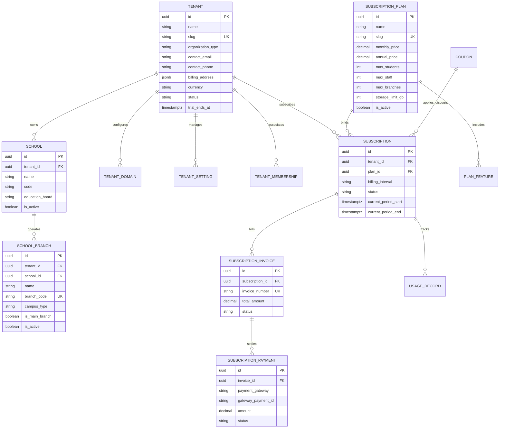
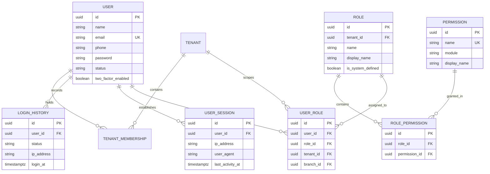
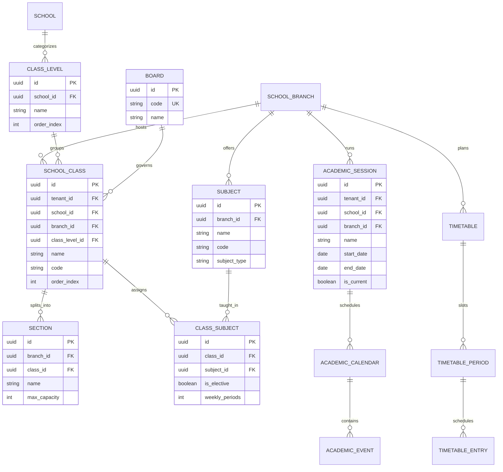
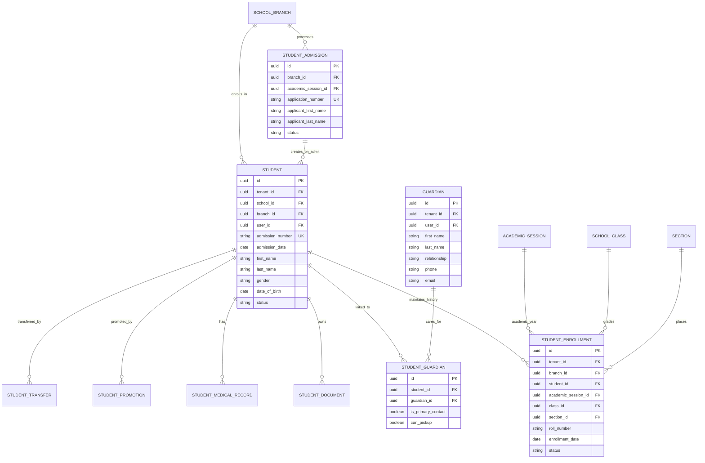
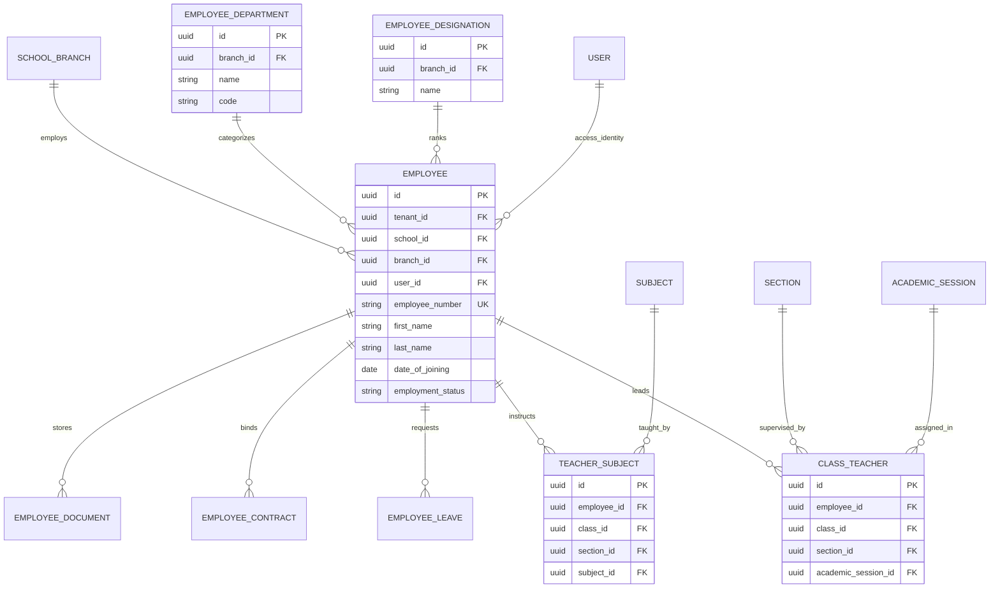
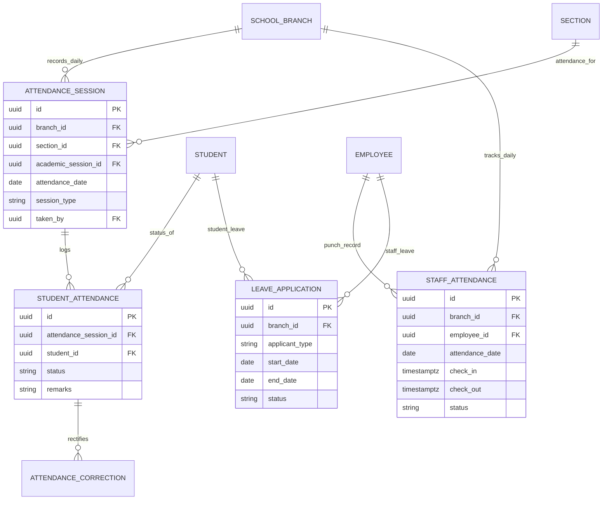
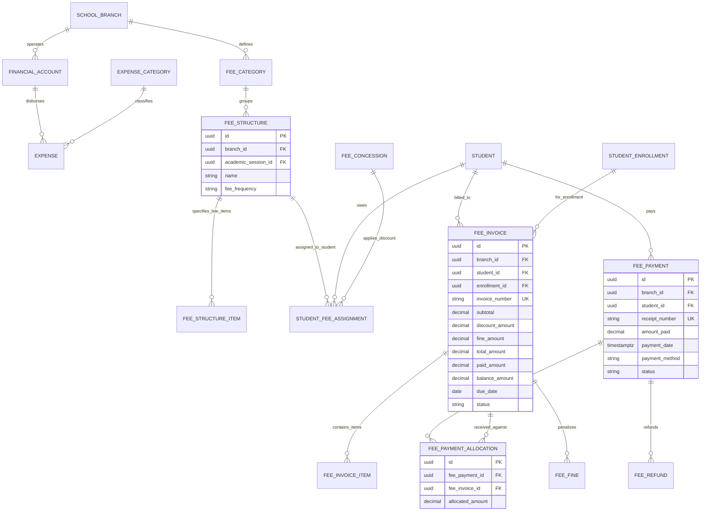
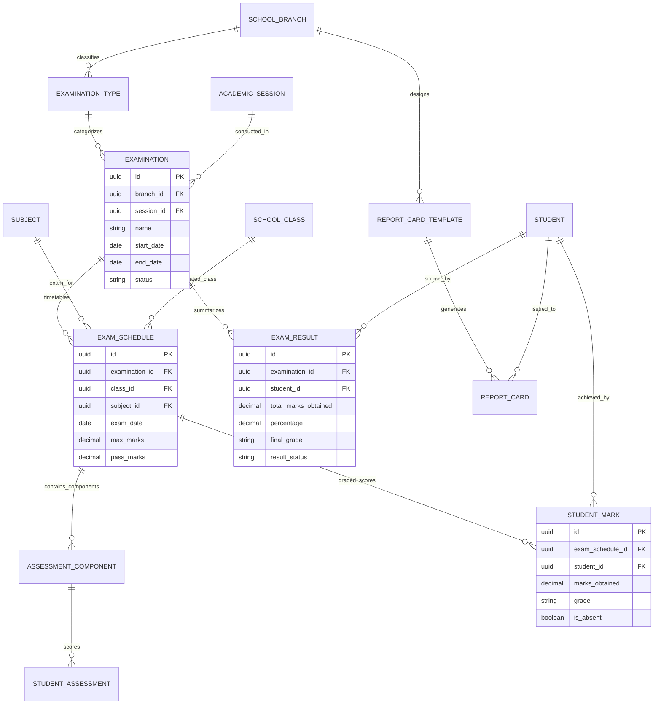
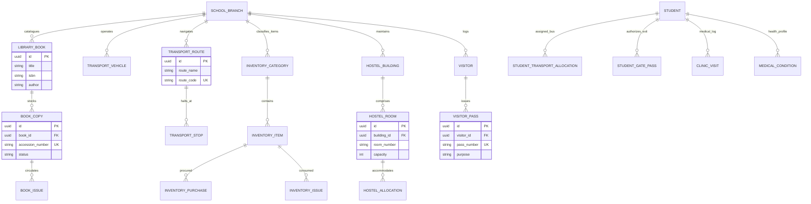
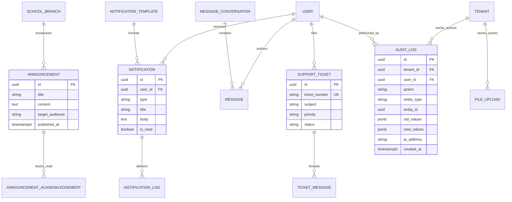

# Entity Relationship Diagram (ERD) Specification
## School ERP SaaS (EduCore Platform)

This document provides complete, modular Entity-Relationship Diagrams (ERD) using Mermaid for all 12 domains across the 133 database tables.

---

## 1. SaaS Core & Subscription Domain

---

## 2. Authentication, Users & Role-Based Access Control (RBAC)

---

## 3. Academic Management Domain

---

## 4. Student Management & Admissions Domain

---

## 5. Staff, Employees & Teacher Allocation

---

## 6. Attendance & Leave Applications

---

## 7. Fee & Financial Management Domain

---

## 8. Examinations, Grading & Results Domain

---

## 9. Operations: Library, Transport, Inventory, Hostel, Visitors & Health

---

## 10. Communication, Support & System Audit

---

## 11. Schema Constraints & Relationship Summary

| Domain | Table Count | Foreign Keys | Unique Constraints | Check Constraints | Indexes |
| :--- | :--- | :--- | :--- | :--- | :--- |
| **SaaS Core** | 6 | 12 | 6 | 14 | 18 |
| **Subscriptions** | 7 | 10 | 4 | 22 | 16 |
| **Auth & RBAC** | 7 | 16 | 5 | 8 | 19 |
| **Academic Management** | 16 | 42 | 14 | 94 | 45 |
| **Staff & HR** | 10 | 28 | 8 | 58 | 27 |
| **Student Management** | 9 | 24 | 9 | 72 | 31 |
| **Attendance & Leaves** | 5 | 16 | 4 | 36 | 18 |
| **Finance & Invoicing** | 16 | 48 | 10 | 184 | 42 |
| **Examinations & Grading** | 12 | 34 | 7 | 98 | 29 |
| **Communications & Tickets** | 9 | 18 | 3 | 32 | 19 |
| **Operations (All 7 sub-units)**| 22 | 72 | 9 | 260 | 48 |
| **System, Files & Auditing** | 5 | 14 | 2 | 50 | 14 |
| **Core Framework (Cache, Jobs, Sessions, etc.)** | 9 | 20 | 0 | 0 | 0 |
| **TOTAL** | **133** | **354** | **81** | **928** | **326** |

