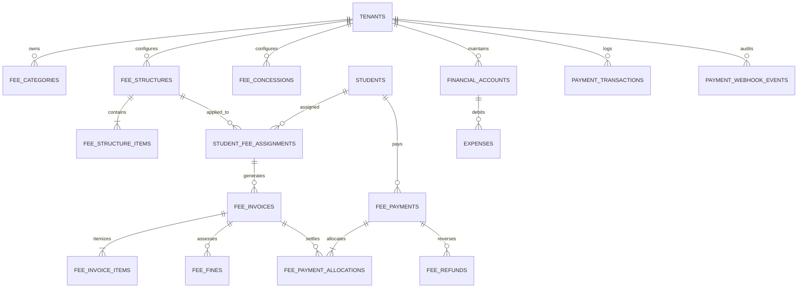

# School Fee and Financial Management Architecture

## 1. Executive Summary

The **Fee and Financial Management System** in EduCore School ERP SaaS delivers enterprise-grade financial accounting, multi-frequency student billing, omnichannel payment processing (Cash, UPI, Cheque, Bank Transfer, Card, and Razorpay Sandbox), thread-safe receipting, immutable transaction ledgers, fine and concession workflows, school expense voucher tracking, and compliance delinquency reporting.

---

## 2. Core Architectural & Financial Principles

### 2.1 Complete Separation of School Fees from SaaS Billing
- **School Fees Billing**: Pertains to tuition, computer lab, sports, examination, hostel, transport, and library fees paid by student parents to individual schools.
- **SaaS Platform Billing**: Pertains to monthly/annual software subscription charges paid by the school organization (tenant) to EduCore SaaS.
- Database tables, ledger models, API endpoints, payment gateways, and accounting contexts for school fees are completely isolated from tenant subscription billing tables (`subscriptions`, `subscription_invoices`, `subscription_payments`).

### 2.2 Strict Invariant of Immutable Financial Ledgers
- Tables storing payments (`fee_payments`), line allocations (`fee_payment_allocations`), and gateway logs (`payment_transactions`) are strictly **immutable**.
- Neither soft-deletes nor hard-deletes are supported or permitted on these models.
- Financial adjustments and reversals must occur exclusively through explicit reversal transactions (`fee_refunds`), preserving complete chronological audit integrity.

### 2.3 Invoice and Payment Separation
- **`fee_invoices`**: Represents the billing obligation, due dates, subtotal, policy concessions, late fee fines, and outstanding balances.
- **`fee_payments`**: Represents actual funds received from the student/parent, receipt number, payment date, channel, and bank ledger.
- **`fee_payment_allocations`**: Serves as the junction ledger mapping a payment to specific invoice items or FIFO against oldest invoices, allowing partial payments and split receipts.

### 2.4 Server-Side Payment Verification & Idempotency
- Frontend payment status is never trusted.
- For Razorpay online payments, order creation is recorded in `payment_transactions` (`status = 'initiated'`).
- The payment verification endpoint calculates expected HMAC-SHA256 signatures server-side:
  $$\text{Expected Signature} = \text{HMAC-SHA256}(\text{order\_id} \mathbin{\Vert} \text{"|"} \mathbin{\Vert} \text{payment\_id}, \text{secret})$$
- Tampered or fake signatures are rejected immediately.
- Incoming webhooks (`/api/v1/webhooks/razorpay`) verify `X-Razorpay-Signature` and enforce strict deduplication against `payment_webhook_events.event_id`, preventing replay attacks.

### 2.5 Thread-Safe Sequential Numbering
Every financial document uses atomic sequential numbering per tenant:
- **Fee Invoices**: `INV-YYYY-XXXXX` (e.g. `INV-2026-00001`)
- **Receipts**: `REC-YYYY-XXXXX` (e.g. `REC-2026-00001`)
- **Refund Vouchers**: `REF-YYYY-XXXXX` (e.g. `REF-2026-00001`)
- **Expense Vouchers**: `VCH-YYYY-XXXXX` (e.g. `VCH-2026-00001`)

---

## 3. Database Entity Relationship Diagram

---

## 4. API Endpoints Catalog

### 4.1 Fee Structures & Categories
| Method | Endpoint | Description | Permissions |
| :--- | :--- | :--- | :--- |
| `GET` | `/api/v1/fees/categories` | List active fee categories | `fees.view` |
| `POST` | `/api/v1/fees/categories` | Create fee category (Tuition, Lab, Transport) | `fees.create` |
| `GET` | `/api/v1/fees/structures` | List class-wise fee structures with item breakdown | `fees.view` |
| `POST` | `/api/v1/fees/structures` | Create fee structure with line items and frequency | `fees.create` |
| `GET` | `/api/v1/fees/structures/{id}` | Get structure details and items | `fees.view` |
| `PUT` | `/api/v1/fees/structures/{id}` | Update structure and item amounts | `fees.edit` |
| `GET` | `/api/v1/fees/concessions` | List fee concessions and scholarships | `fees.view` |
| `POST` | `/api/v1/fees/concessions` | Create percentage or fixed discount concession | `fees.create` |

### 4.2 Student Fee Assignment & Invoices
| Method | Endpoint | Description | Permissions |
| :--- | :--- | :--- | :--- |
| `POST` | `/api/v1/fees/assignments` | Assign structure to student & auto-generate invoice | `fees.create` |
| `GET` | `/api/v1/fees/invoices` | List invoices with status & overdue filters | `fees.view` |
| `GET` | `/api/v1/fees/invoices/{id}` | Get invoice line items, allocations, and fines | `fees.view` |
| `POST` | `/api/v1/fees/invoices/{id}/fine` | Assess late fee fine penalty | `fees.edit` |
| `POST` | `/api/v1/fees/fines/{id}/waive` | Waive fine with audit justification | `fees.edit` |
| `GET` | `/api/v1/fees/ledger/{studentId}` | Complete 360-degree student fee ledger | `fees.view` |

### 4.3 Payments, Razorpay Gateway & Refunds
| Method | Endpoint | Description | Permissions |
| :--- | :--- | :--- | :--- |
| `GET` | `/api/v1/fees/payments` | List payments with allocations and receipts | `fees.view` |
| `GET` | `/api/v1/fees/payments/{id}` | Get payment detail and printable receipt data | `fees.view` |
| `POST` | `/api/v1/fees/payments/collect` | Collect counter payment (Cash, UPI, Cheque, Bank) | `fees.collect` |
| `POST` | `/api/v1/fees/payments/razorpay/order` | Initiate Razorpay sandbox order | `fees.collect` |
| `POST` | `/api/v1/fees/payments/razorpay/verify` | Server-side HMAC-SHA256 signature verification | `fees.collect` |
| `POST` | `/api/v1/fees/payments/{id}/refund` | Process refund as an immutable separate record | `fees.refund` |
| `POST` | `/api/v1/webhooks/razorpay` | Public signature-verified & idempotent webhook | *Public / Webhook* |

### 4.4 Expenses & Financial Accounts
| Method | Endpoint | Description | Permissions |
| :--- | :--- | :--- | :--- |
| `GET` | `/api/v1/finance/accounts` | List bank accounts & cash ledgers | `fees.view` |
| `POST` | `/api/v1/finance/accounts` | Configure bank account with opening balance | `fees.create` |
| `GET` | `/api/v1/finance/expense-categories` | List expense categories | `fees.view` |
| `POST` | `/api/v1/finance/expense-categories` | Create expense category | `fees.create` |
| `GET` | `/api/v1/finance/expenses` | List expense vouchers | `fees.view` |
| `POST` | `/api/v1/finance/expenses` | Record expense voucher (`VCH-YYYY-XXXXX`) | `fees.create` |

### 4.5 Financial Reports
| Method | Endpoint | Description | Permissions |
| :--- | :--- | :--- | :--- |
| `GET` | `/api/v1/finance/reports/daily` | Daily collection grouped by payment method | `fees.view` |
| `GET` | `/api/v1/finance/reports/monthly` | Monthly collection trend and day-wise totals | `fees.view` |
| `GET` | `/api/v1/finance/reports/class-wise` | Class billing, collection, and realization % | `fees.view` |
| `GET` | `/api/v1/finance/reports/outstanding` | Outstanding fee register | `fees.view` |
| `GET` | `/api/v1/finance/reports/defaulters` | Defaulters register (> 15 days overdue) | `fees.view` |
| `GET` | `/api/v1/finance/reports/payment-methods` | Gateway and channel volume share | `fees.view` |
| `GET` | `/api/v1/finance/reports/refunds` | Processed refund summary | `fees.view` |
| `GET` | `/api/v1/finance/reports/summary` | Net operating cash flow & account balances | `fees.view` |

---

## 5. Verification Results

### 5.1 Automated Backend Feature Tests
All **14 Feature Tests** in `Tests\Feature\FeeAndFinancialManagementTest` passed with 111 assertions:
1. `it_can_create_fee_category`
2. `it_can_create_fee_structure_with_line_items`
3. `it_can_configure_fee_concessions`
4. `it_assigns_fee_structure_to_student_and_generates_invoice_with_concession`
5. `it_collects_payment_generates_sequential_receipt_and_allocates_to_invoices`
6. `it_supports_multiple_partial_payments_and_completes_student_fee_ledger`
7. `it_initiates_razorpay_order_and_creates_payment_transaction_record`
8. `it_verifies_valid_razorpay_signature_and_rejects_tampered_signature`
9. `it_processes_razorpay_webhook_idempotently_and_prevents_duplicate_replay`
10. `it_applies_and_waives_late_fee_fines_accurately`
11. `it_processes_refund_as_an_immutable_separate_transaction_and_restores_invoice_balance`
12. `it_records_school_expenses_and_updates_financial_account_balance`
13. `it_generates_accurate_financial_and_defaulters_reports`
14. `it_enforces_strict_tenant_isolation_on_fee_invoices_and_payments`

### 5.2 Full Test Suite Status
- Total Passing Tests: **76 Tests**
- Total Assertions: **637 Assertions**
- Total Failures: **0**

