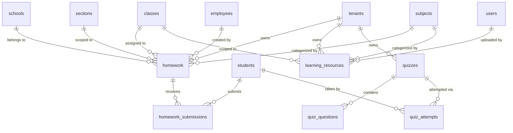

# Homework, Assignment, Learning Management (LMS) & Unified Portals

## 1. Executive Summary

The **Learning Management System (LMS) & Unified Portals** module provides an end-to-end digital learning, assessment, and communication hub for EduCore School ERP SaaS. It unifies academic coursework workflows with mobile-first dedicated portals for **Students**, **Parents**, and **Teachers**—all communicating through a secure, multi-tenant Laravel 12 API layer and Next.js 16 App Router interface.

### Core Capabilities
- **Homework & Coursework Management**: Class-, section-, and subject-wise assignment creation with due dates, maximum marks, and document attachments (PDFs, images, cloud storage links).
- **Online Assignment Submissions**: Digital student submissions, automatic late submission tracking against deadlines (`is_late`), teacher evaluation with marks and feedback, and an iterative resubmission workflow (`resubmission_requested`, `resubmission_count`).
- **Learning Resources & Study Materials**: Structured repository of notes, PDFs, embedded lecture videos (YouTube, MP4), and reference URLs organized subject-wise and class-filtered.
- **Online Timed Quizzes & Automatic Scoring**: Support for Multiple-Choice Questions (MCQ), True/False, and Short Answer question types with live countdown timers, attempt tracking, and instant automated grading.
- **Student Portal**: Mobile-first dashboard featuring student biodata, attendance statistics, daily timetable schedule, pending homework with online submission, exam timetables, report cards, library records, and school notices.
- **Parent Portal**: Multi-child switcher pills allowing guardians to toggle between enrolled children, strict guardian-child access verification, fee invoice balances, payment receipts ledger, academic report cards, leave applications, and teacher communication tickets.
- **Teacher Portal**: Teacher workload summary, assigned classes/subjects badges, weekly timetable schedule, today's attendance check, pending submissions grading desk, and class performance analytics.

---

## 2. Database Architecture & Schema

The module introduces 6 dedicated PostgreSQL tables with full UUID primary keys, multi-tenant foreign keys, and soft deletes.



### Table Definitions

#### 1. `homework`
| Column | Type | Constraints | Description |
|---|---|---|---|
| `id` | UUID | Primary Key | Unique homework identifier |
| `tenant_id` | UUID | FK -> `tenants.id` ON DELETE CASCADE | Multi-tenant identifier |
| `branch_id` | UUID | FK -> `school_branches.id` ON DELETE CASCADE | School branch |
| `class_id` | UUID | FK -> `classes.id` ON DELETE CASCADE | Target class |
| `section_id` | UUID | FK -> `sections.id` ON DELETE SET NULL | Optional section targeting |
| `subject_id` | UUID | FK -> `subjects.id` ON DELETE CASCADE | Subject |
| `teacher_id` | UUID | FK -> `employees.id` ON DELETE CASCADE | Teacher creator |
| `title` | VARCHAR(255) | NOT NULL | Assignment title |
| `description` | TEXT | NOT NULL | Homework prompt/instructions |
| `assigned_date` | DATE | NOT NULL | Date issued |
| `due_date` | DATE | NOT NULL | Submission deadline |
| `max_marks` | NUMERIC(5,2) | Default: 10.00 | Total possible marks |
| `attachments` | JSONB | Nullable | Document name, URL, size list |
| `is_active` | BOOLEAN | Default: true | Visibility flag |
| `created_at`, `updated_at`, `deleted_at` | TIMESTAMPTZ | Soft deletes enabled | Audit timestamps |

#### 2. `homework_submissions`
| Column | Type | Constraints | Description |
|---|---|---|---|
| `id` | UUID | Primary Key | Submission identifier |
| `homework_id` | UUID | FK -> `homework.id` ON DELETE CASCADE | Associated homework |
| `student_id` | UUID | FK -> `students.id` ON DELETE CASCADE | Submitting student |
| `submission_text` | TEXT | Nullable | Solution notes or text answer |
| `attachments` | JSONB | Nullable | Attached PDF or file URLs |
| `submitted_at` | TIMESTAMPTZ | NOT NULL | Timestamp of submission |
| `is_late` | BOOLEAN | Default: false | True if submitted past due date |
| `status` | VARCHAR(30) | Default: 'submitted' | `submitted`, `graded`, `resubmission_requested` |
| `marks_obtained` | NUMERIC(5,2) | Nullable | Score awarded by teacher |
| `teacher_feedback` | TEXT | Nullable | Correction notes and feedback |
| `evaluated_at` | TIMESTAMPTZ | Nullable | Grading timestamp |
| `evaluated_by` | UUID | FK -> `users.id` NULL ON DELETE | Grading evaluator |
| `resubmission_count` | INT | Default: 0 | Number of resubmission cycles |
| `created_at`, `updated_at` | TIMESTAMPTZ | Standard timestamps | Audit timestamps |

#### 3. `learning_resources`
| Column | Type | Constraints | Description |
|---|---|---|---|
| `id` | UUID | Primary Key | Resource identifier |
| `tenant_id` | UUID | FK -> `tenants.id` ON DELETE CASCADE | Multi-tenant identifier |
| `branch_id` | UUID | FK -> `school_branches.id` ON DELETE CASCADE | Branch scope |
| `class_id` | UUID | FK -> `classes.id` ON DELETE CASCADE | Class filter |
| `section_id` | UUID | FK -> `sections.id` NULL ON DELETE | Optional section filter |
| `subject_id` | UUID | FK -> `subjects.id` ON DELETE CASCADE | Subject categorization |
| `uploaded_by` | UUID | FK -> `users.id` ON DELETE CASCADE | Author / Uploader |
| `title` | VARCHAR(255) | NOT NULL | Material title |
| `description` | TEXT | Nullable | Overview & summary |
| `resource_type` | VARCHAR(30) | NOT NULL | `document`, `notes`, `video`, `link` |
| `file_url` | VARCHAR(500) | Nullable | PDF or document storage path |
| `video_url` | VARCHAR(500) | Nullable | YouTube or video stream URL |
| `is_published` | BOOLEAN | Default: true | Publication status |

#### 4. `quizzes`, `quiz_questions`, and `quiz_attempts`
- **`quizzes`**: Configures quiz duration in minutes, total marks, passing threshold, and availability dates.
- **`quiz_questions`**: Supports question formats `multiple_choice`, `true_false`, and `short_answer` with JSONB options and explanation fields.
- **`quiz_attempts`**: Records student attempts, tracks score, calculated percentage, pass/fail status, and student response JSON.

---

## 3. Business Rules & Security

### 1. Teacher Assignment Authorization
- When a teacher creates homework, assigns study materials, or enters marks, the system verifies via `TeacherSubject` that the teacher is authorized to teach that class and subject in the branch.
- Platform Admins and School Admins possess override authority (`homework.manage`, `lms.manage`).

### 2. Parent-Child Relationship Access Control
- Parents and guardians **can only** query information, submit leaves, and message teachers for students linked to their user account via the `student_guardians` junction table.
- Attempting to access another student's ID or records immediately throws `403 Forbidden` (`AuthorizationException: You are not authorized to view records for this student.`).

### 3. Tenant Isolation
- Every database query utilizes the Eloquent `TenantScoped` global scope and `TenantMiddleware`.
- Cross-tenant requests with invalid `X-Tenant-ID` headers are rejected with `403 Forbidden` or `404 Not Found`.

### 4. Late Submission Tracking & Resubmission Workflow
- Submissions past midnight of `due_date` automatically set `is_late = true`.
- Teachers can issue a resubmission request with targeted feedback (`status = 'resubmission_requested'`).
- When the student resubmits, `resubmission_count` increments, resetting status to `submitted` for re-grading.

---

## 4. API Specification

All endpoints are prefixed with `/api/v1` and protected by `auth:sanctum` and `tenant` middleware.

### Learning Management System (LMS)
| Method | Endpoint | Description | Permissions |
|---|---|---|---|
| `GET` | `/lms/homework` | List homework with class, section, subject filters | `homework.view` |
| `POST` | `/lms/homework` | Create new homework assignment | `homework.create` |
| `GET` | `/lms/homework/{id}` | Get homework details and attachments | `homework.view` |
| `PUT` | `/lms/homework/{id}` | Update homework assignment | `homework.edit` |
| `DELETE` | `/lms/homework/{id}` | Soft delete homework assignment | `homework.delete` |
| `POST` | `/lms/homework/{id}/submit` | Student online assignment submission | `homework.submit` |
| `GET` | `/lms/homework/{id}/submissions` | List student submissions for homework | `homework.grade` |
| `POST` | `/lms/submissions/{id}/grade` | Grade submission with marks & feedback | `homework.grade` |
| `POST` | `/lms/submissions/{id}/resubmit-request` | Request student resubmission | `homework.grade` |
| `GET` | `/lms/resources` | List class study resources & videos | `lms.view` |
| `POST` | `/lms/resources` | Upload document or video lecture link | `lms.upload` |
| `GET` | `/lms/quizzes` | List available online quizzes | `lms.view` |
| `POST` | `/lms/quizzes` | Create timed quiz configuration | `lms.create` |
| `POST` | `/lms/quizzes/{id}/questions` | Add question to quiz | `lms.create` |
| `POST` | `/lms/quizzes/{id}/attempt` | Start new quiz attempt | `lms.view` |
| `POST` | `/lms/quizzes/{id}/submit` | Submit answers and trigger auto-scoring | `lms.view` |

### Unified Portals
| Method | Endpoint | Description | Guard / Roles |
|---|---|---|---|
| `GET` | `/portal/student/dashboard` | Student mobile-first dashboard data | `student`, `school_admin` |
| `GET` | `/portal/student/timetable` | Student weekly period schedule | `student`, `school_admin` |
| `GET` | `/portal/student/resources` | Student class study materials | `student`, `school_admin` |
| `GET` | `/portal/parent/children` | List linked children for guardian | `parent`, `school_admin` |
| `GET` | `/portal/parent/children/{id}/dashboard` | Selected child academic & fee overview | Verified guardian |
| `GET` | `/portal/parent/children/{id}/fees` | Child fee invoices & payment ledger | Verified guardian |
| `POST` | `/portal/parent/children/{id}/leave` | Submit student leave request | Verified guardian |
| `POST` | `/portal/parent/children/{id}/communicate` | Send support note to school staff | Verified guardian |
| `GET` | `/portal/teacher/dashboard` | Teacher workload & evaluation queue | `teacher`, `class_teacher` |
| `GET` | `/portal/teacher/timetable` | Teacher weekly timetable grid | `teacher`, `class_teacher` |
| `GET` | `/portal/teacher/performance/{cId}/{sId}`| Class student performance analytics | Assigned teacher |

---

## 5. Verification & Quality Assurance

### Test Suite Results
The entire backend test suite was executed against local PostgreSQL 18 on port 5433:

```text
PASS  Tests\Feature\LmsAndPortalsTest
✓ teacher creates homework and unauthorized teacher is blocked        0.92s
✓ student assignment submission and late tracking                     0.42s
✓ teacher evaluation and resubmission lifecycle                       0.55s
✓ learning resources upload and class access                          0.40s
✓ online quiz creation and automatic scoring                          0.47s
✓ student portal dashboard and modules                                0.47s
✓ parent portal linked children and blocks unauthorized access        0.43s
✓ parent can submit leave and send communication                      0.47s
✓ teacher portal dashboard and performance                            0.52s
✓ tenant isolation on lms records                                     0.39s

Tests:    10 passed (75 assertions)
Duration: 5.35s

Full Backend Suite:
Tests:    97 passed (785 assertions)
Duration: 30.73s
```

### Frontend Build & Typecheck
- **TypeScript**: `npx tsc --noEmit` passed with 0 errors.
- **Next.js Production Build**: Compiled all App Router static and dynamic pages (`/lms`, `/portal/student`, `/portal/parent`, `/portal/teacher`).

