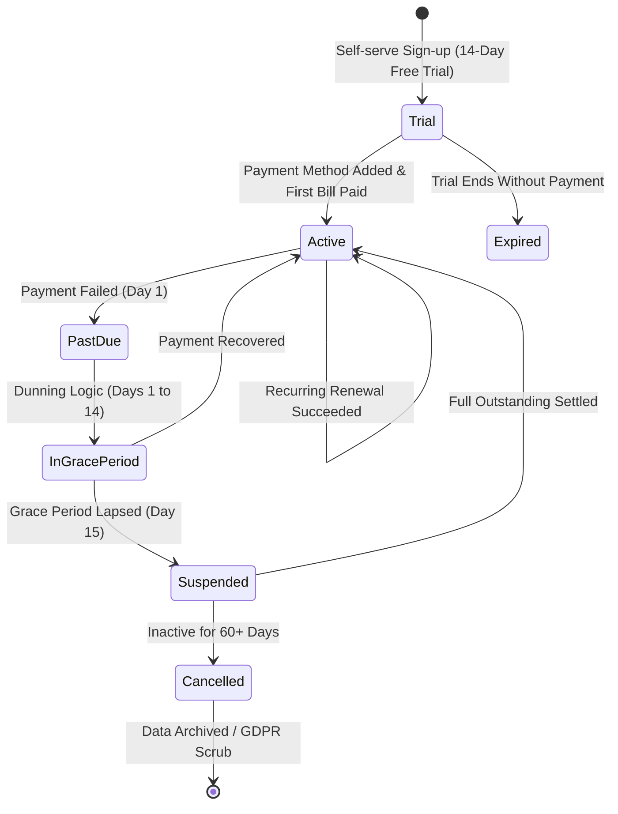

# Product Requirements Document (PRD)
## Project: Multi-Tenant School Management System (School ERP SaaS)
**Document Version:** 1.0.0  
**Target Release:** Production v1.0  
**Author:** Senior SaaS Product Architect & Technical Lead  
**Status:** Approved for Architecture & Design  

---

## 1. Executive Summary & Product Vision

### 1.1 Executive Summary
The School ERP SaaS is a commercial, cloud-native, multi-tenant Software-as-a-Service (SaaS) platform engineered to empower modern educational institutions ranging from single-campus independent schools to large multi-branch educational conglomerates. It provides end-to-end operational automation across academics, admissions, financials, staff operations, student lifecycles, and stakeholder communications.

### 1.2 Target Market & Board Agnosticism
Education institutions operate under diverse pedagogical frameworks and administrative standards. The platform is architected to be completely board-agnostic through configurable academic engines rather than hardcoded compliance rules:
- **Central Boards:** CBSE (Continuous and Comprehensive Evaluation - CCE, Assessment of Speaking and Listening - ASL, board exam formats), ICSE/ISC.
- **State Education Boards:** Diverse Indian State Boards (SSLC, HSC) and regional evaluation patterns.
- **International Boards:** Cambridge (CAIE / IGCSE), International Baccalaureate (IB - PYP, MYP, DP).
- **Private & Alternative Schools:** Montessori, Waldorf, and independent charters.
- **Language Mediums:** English, Hindi, and regional-language support via internationalization (i18n).
- **Campus Topologies:** Single-branch standalones and multi-branch educational trusts / group of institutions.

### 1.3 Key Value Propositions
1. **True Multi-Tenancy:** Complete logical isolation per school organization with multi-branch operational hierarchies.
2. **Subscription Monetization:** Fully automated billing lifecycle (trial, self-service checkout, automated recurring invoices, grace period throttling, hard suspension).
3. **Consumer-Grade UX:** Modern, high-density dashboard inspired by Linear and Stripe, built on Next.js 15, Tailwind CSS, and shadcn/ui.
4. **Data Privacy & Governance:** High compliance standards (FERPA, GDPR, Indian DPDP Act) featuring PostgreSQL Row-Level Security (RLS) and cryptographic tenant separation.

---

## 2. Stakeholder Personas & Role Matrix

The platform serves two overarching operational realms: **Platform Level (SaaS Owner)** and **School/Tenant Level**.

### 2.1 Platform Personas
| Role | Primary Objectives | Key Privileges |
| :--- | :--- | :--- |
| **Platform Super Admin** | Oversee platform health, tenant provisioning, revenue, billing enforcement, feature toggles. | Unrestricted platform-wide access, tenant impersonation, global plan configuration. |
| **Platform Support Admin**| Troubleshoot school-reported issues, monitor operational logs, verify billing anomalies. | Read-only access to tenant metrics, scoped customer support impersonation with audit trails. |

### 2.2 School / Tenant Personas
| Role | Focus Area | Core Responsibilities & Workflows |
| :--- | :--- | :--- |
| **School Owner / Trustee** | Strategic & Financial Oversight | Multi-branch analytics, gross revenue, fee collection trends, staff payroll summaries, macro-governance. |
| **School Admin** | Daily Administrative Command | Complete operational authority within assigned school branch, user provisioning, academic calendar setup. |
| **Principal** | Academic & Pedagogical Leadership | Teacher evaluations, curriculum progress, exam approval, student discipline, parent escalation management. |
| **Vice Principal** | Timetable & Operational Logistics | Timetable substitution, day-to-day discipline, event coordination, staff duty scheduling. |
| **Accountant** | Financial Operations & Cash Flow | Fee collections, concessions, invoices, expense entries, bank reconciliations, payroll disbursement. |
| **Admission Officer** | Enrollment Pipeline & CRM | Lead generation, applicant follow-ups, entrance tests, document verification, enrollment conversion. |
| **Teacher** | Classroom Delivery & Assessment | Attendance logging, marks entry, homework creation, syllabus tracking, student remarks. |
| **Class Teacher** | Cohort Pastoral Care | Class attendance collation, report card compilation, parent-teacher meeting logs, student behavior logs. |
| **Librarian** | Media & Resource Management | Book cataloging, barcode scanning, issue/return circulation, fine collection, inventory audit. |
| **Transport Manager** | Fleet Logistics & Safety | Route planning, vehicle tracking, stop assignment, driver roster, maintenance logs. |
| **HR Manager** | Staff Lifecycle & Compliance | Recruitment, biometric attendance reconciliation, leave approvals, payroll generation, performance reviews. |
| **Receptionist** | Front Office & Visitor Security | Visitor badge generation, gate passes, phone inquiries, incoming courier management. |
| **Parent / Guardian** | Student Progress & Financial Dues | Online fee payment, live bus tracking, attendance review, report card downloads, teacher messaging. |
| **Student** | Self-Service Learning & Activities | Homework submissions, exam schedules, timetable viewing, digital library access, attendance records. |
| **Driver / Bus Attendant** | Transport Route Execution | Route check-in, student pickup/drop attendance confirmation, emergency dispatch alerts. |

---

## 3. SaaS Business Model & Subscription Engine

### 3.1 Pricing Tiers & Entitlements
| Tier | Target Institution | Student Cap | Storage Limit | Modules Included | Support SLA |
| :--- | :--- | :--- | :--- | :--- | :--- |
| **Starter** | Small single-campus schools | Up to 300 | 10 GB | Core Academics, Student Info, Attendance, Basic Fees | Standard (48 hrs) |
| **Growth** | Growing mid-sized schools | Up to 1,500 | 50 GB | All Starter + Exams, Homework, Library, Transport, Portals | Priority (12 hrs) |
| **Enterprise** | Large multi-branch networks | Unlimited | 500 GB+ | All Modules (Hostel, HR/Payroll, Gate Pass, Custom Reports, API) | 24/7 Dedicated Manager |

### 3.2 Subscription Lifecycle Management

- **Grace Period Policies:** 14 calendar days of soft-past-due access where operational banners warn administrators.
- **Tenant Suspension Enforcement:** Automated middleware redirects non-admin users to a "Service Paused" screen; School Owner retains access strictly to the Billing Checkout module.
- **Usage Throttling:** Strict rejection on exceeding student count limits, active staff counts, or Supabase storage quotas unless upgraded to next tier.

---

## 4. Comprehensive Product Modules Specification

The system comprises 30 fully integrated, loosely coupled modules.

### Module 1: SaaS Platform Administration
- **Global Overview:** Real-time MRR, ARR, churn rate, active tenants, server load, and storage metrics.
- **Tenant Management:** Provision, suspend, reactivate, or archive tenants.
- **Plan Manager:** Define custom subscription tiers, pricing intervals (monthly, annual, multi-year), and feature entitlement matrix.
- **Impersonation Support:** Secure time-bound audit-logged impersonation of school admins for tier-2 customer support.

### Module 2: Tenant and School Management
- **Hierarchical Structure:** `Tenant Organization` (e.g., "St. Jude Group of Institutions") -> `Schools/Branches` (e.g., "North Campus", "South Campus").
- **Branch Independence:** Individual branches maintain dedicated academic sessions, staff rosters, and financial accounts while reporting up to the parent tenant.
- **Configurable Localization:** Per-branch currency, time zone, date formats, and academic year start/end dates.

### Module 3: Subscription and Billing
- **Payment Gateway Integration:** Stripe Billing & Razorpay Subscriptions supporting automated recurring credit card, NetBanking, and UPI mandates.
- **Automated Invoicing:** System-generated tax-compliant PDF invoices with configurable GST/VAT identifiers.
- **Add-on Packs:** Purchase supplementary storage blocks (100 GB increments) or bulk SMS/WhatsApp credit bundles.

### Module 4: School Onboarding
- **Interactive Setup Wizard:** Guided step-by-step setup (School Identity -> Academic Term -> Grading Scale -> Class & Section Structure -> Fee Heads).
- **Bulk Data Migration:** High-speed XLSX/CSV import pipelines with real-time row-by-row validation, error reporting, and rollback capabilities.
- **Sample Template Generator:** Dynamic download of pre-formatted import templates based on school configuration.

### Module 5: Authentication and User Management
- **Unified Identity System:** Email/phone authentication powered by Laravel Sanctum bearer tokens with multi-tenant domain resolution.
- **Enterprise Security:** Mandatory Two-Factor Authentication (2FA) via TOTP (Google Authenticator) for administrative roles.
- **Session Governance:** Concurrent session limits, device tracking, forced logout across all devices, and password expiry policies.

### Module 6: Role-Based Access Control (RBAC)
- **Tenant-Scoped Authorization:** Spatie Laravel Permission extended with compound tenant keys `(tenant_id, school_id)`.
- **Granular Action Matrix:** Explicit capabilities: `view`, `create`, `edit`, `delete`, `approve`, `export`, and `print`.
- **Custom Role Builder:** Ability for School Owners to create custom roles (e.g., "Lab Assistant", "Discipline Head") with custom permission sets.

### Module 7: Academic Management
- **Board Configuration:** Define evaluation rules (CBSE, ICSE, IB, State Boards).
- **Academic Hierarchy:** Academic Year -> Terms/Semesters -> Classes (Grades) -> Sections -> Subjects (Core & Elective).
- **Subject-Teacher Mapping:** Dynamic assignment of primary, co-teacher, and substitute teachers to specific class sections.

### Module 8: Student Management
- **360-Degree Profile:** Comprehensive demographic, medical (allergies, blood group), dietary, previous schooling, and identification data.
- **Student Document Vault:** Secure storage for birth certificates, transfer certificates, immunization records, and national IDs via private Supabase buckets.
- **Lifecycle Tracking:** Enrollment -> Promotion -> Detention -> Transfer -> Alumni status transitions.

### Module 9: Admission Management
- **Inquiry & Lead Management:** Inbound inquiry capture via public embeddable forms, walk-in registration, and lead stage tracking.
- **Application Workflow:** Application submission -> Fee payment -> Entrance test scheduling -> Interview scoring -> Offer letter issuance.
- **One-Click Enrollment:** Seamless promotion of accepted applicants into active students without redundant data entry.

### Module 10: Parent and Guardian Management
- **Guardian Relations:** Father, Mother, Legal Guardian, and Emergency Contact tracking.
- **Multi-Child Linkage:** Unified parent account allowing single-click switching between siblings enrolled in different classes or branches.
- **Custody & Communication Flags:** Permissions detailing who has legal custody, pick-up rights, and billing invoice receipt rights.

### Module 11: Teacher and Staff Management
- **Staff Directory:** Comprehensive academic and non-academic employee records (qualifications, experience, statutory numbers like PAN/EPF).
- **Staff Document Repository:** Verified contracts, credential certificates, police verification forms, and resume archives.
- **Departmental Structure:** Department -> Designation hierarchies with direct reporting manager mappings.

### Module 12: Attendance Management
- **Attendance Paradigms:** Support for Daily Morning Attendance, Twice-Daily, and Subject/Period-wise tracking.
- **Biometric & RFID Integration:** Webhook and API listeners for biometric fingerprint terminals and RFID walk-through gates.
- **Leave Application Engine:** Multi-level leave approvals (Student -> Class Teacher -> Principal; Staff -> HOD -> HR).

### Module 13: Fee and Financial Management
- **Configurable Fee Architecture:** Fee Categories, Fee Heads, Frequency (Annual, Term, Monthly), and Section-specific structures.
- **Concessions & Scholarships:** Merit scholarships, sibling discounts, and staff concessions with approval audit trails.
- **Collection & Gateway:** Online collections (Credit Cards, Debit Cards, NetBanking, UPI) and offline collections (Cash, Cheque, DD, POS).
- **Automated Fine Calculations:** Daily or slab-based late payment penalties.
- **Defaulter Management:** Automated SMS/Email dunning notices and printable reminder notices.

### Module 14: Examination and Result Management
- **Exam Framework:** Flexible configuration for Unit Tests, Half-Yearly, Final Exams, Practical Assessments, and Oral Assessments.
- **Grading Scale Customization:** Percentage-based, GPA (4.0 / 10.0), CCE 9-point scale, or Letter Grade (A+, A, B, etc.) with custom grade boundary points.
- **Tabulation & Mark Entry:** Rapid tabular mark entry with Min/Max validation, absent flagging, and moderation adjustments.
- **Report Card Engine:** High-resolution PDF generation with school insignia, graphical score distributions, and teacher remarks.

### Module 15: Timetable Management
- **Timetable Grid Designer:** Drag-and-drop schedule builder enforcing conflict validation (preventing teacher double-booking and room collisions).
- **Workload Balancing:** Monitoring teacher weekly period allocations against statutory limits.
- **Smart Substitutions:** Automated substitute suggestions based on teacher availability, subject alignment, and current period load.

### Module 16: Homework and Assignment Management
- **Digital Assignments:** Rich text assignment briefs with PDF/document attachment support.
- **Submission Portals:** Students submit document/image proofs; teachers review, annotate, grade, and return feedback.
- **Plagiarism & Deadline Rules:** Late submission penalty calculations and submission lockouts.

### Module 17: Parent Portal
- **Mobile-Responsive Overview:** Real-time visibility into student attendance, homework, notices, and upcoming assessments.
- **Frictionless Fee Payments:** Integrated one-click fee clearing with instant PDF receipt generation.
- **Direct Teacher Messaging:** Controlled communication channel with designated teachers without disclosing personal phone numbers.

### Module 18: Student Portal
- **Personalized Learning Hub:** Daily class timetable, homework submissions, exam admit card downloads, and library borrowing history.
- **Digital Noticeboard:** Filtered school circulars, event alerts, and club announcements.

### Module 19: Teacher Portal
- **Classroom Console:** Rapid attendance marking, pending homework evaluations, gradebook entry, and student remarks.
- **Timetable & Substitution Hub:** Live schedule view with instant notifications regarding emergency substitution assignments.
- **Personal Leave Dashboard:** Leave quota overview, leave application, and tracking.

### Module 20: Library Management
- **Accession & Cataloging:** Dewey Decimal / Library of Congress indexing, ISBN lookup, book classification, and barcode/QR generation.
- **Circulation Desk:** Barcode scanner-enabled check-out, return, renewals, and reservation queuing.
- **Lost & Damage Management:** Book replacement fee calculation and automated fine integration with the student fee ledger.

### Module 21: Transport Management
- **Fleet & Crew Management:** Vehicle fitness certificate tracking, insurance renewals, pollution checks, and driver license management.
- **Route Optimization:** Route -> Stops -> Fee Mapping -> Student Allocation.
- **Safety & Tracking:** Real-time GPS coordinate ingestion via mobile driver app or OBD-II tracker; ETA geofence SMS alerts for parents.

### Module 22: Inventory Management
- **Item Master & Categorization:** Asset tagging (desks, projectors, lab equipment) vs consumable items (stationery, chalk, sanitizers).
- **Vendor & Procurement:** Vendor master, purchase orders, goods received notes (GRN), and invoice reconciliation.
- **Stock Disbursement:** Departmental requisitions, inter-branch transfers, and low-stock replenishment alerts.

### Module 23: Payroll and HR
- **Salary Components:** Configurable earnings (Basic, HRA, DA, Special Allowance) and statutory deductions (PF, ESI, TDS, Professional Tax).
- **Payroll Processing:** Automated attendance-linked monthly salary slips, bank transfer CSV generation, and tax projection reports.
- **Performance Appraisals:** Key Performance Indicator (KPI) tracking, annual appraisal forms, and increments.

### Module 24: Hostel Management
- **Facility Mapping:** Hostel buildings, floors, room categories (AC, Non-AC, Dormitory), and bed capacities.
- **Allocation & Mess:** Room allotment, vacation workflows, mess attendance, and meal dietary preference logs.
- **Warden Discipline Logs:** Night roll calls, out-pass tracking, and visitor logging for boarders.

### Module 25: Communication and Notifications
- **Multi-Channel Dispatcher:** SMS (Twilio/AWS SNS/Gupshup), Email (Resend/SendGrid/Postmark), WhatsApp Business API, and Web Push.
- **Event-Driven Triggers:** Automated triggers (Fee Due, Absent Without Leave, Exam Schedule Published, Emergency School Closure).
- **Broadcast Composer:** Audience segmentation (e.g., "All parents of Grade 10 Section B") with template compliance checks.

### Module 26: Certificate Generation
- **Dynamic Template Studio:** HTML/CSS drag-and-drop or tokenized template builder for Transfer Certificates (TC), Bonafide Certificates, Character Certificates, and Student ID Cards.
- **Verification QR Codes:** Tamper-proof verification QR codes printed on physical certificates linking to a public verification page.
- **Issuance Audit Register:** Strict serial number generation and historical issuance logs.

### Module 27: Visitor and Gate Pass Management
- **Visitor Check-In:** Webcam photo capture, national ID recording, host staff selection, and automated host WhatsApp approval.
- **Gate Pass Issuance:** Thermal printed visitor badges and digital gate passes with QR checkout validation.
- **Early Student Exit:** Strict parental consent validation before generating a student early-exit gate pass.

### Module 28: Reports and Analytics
- **Executive BI Dashboards:** Year-on-year enrollment shifts, fee realization ratios, student-to-teacher ratios, and academic performance distribution.
- **Statutory Compliance Exports:** Pre-formatted reports compliant with government education departments (e.g., UDISE+ in India).
- **Export Framework:** Streaming high-performance exports to Excel, CSV, and vector-rendered PDF.

### Module 29: Helpdesk and Complaint Management
- **Ticketing Engine:** Parent and staff ticketing for academic, transport, fee, or facility grievances.
- **SLA & Escalation:** Category-based Service Level Agreements (e.g., Transport issues resolve in 24h) with automated escalation to the Principal.
- **Internal Collaboration:** Internal staff notes, resolution history, and customer satisfaction rating (CSAT) surveys.

### Module 30: Audit Logs and Security
- **Immutable Audit Trail:** Append-only logging of all administrative mutations: actor, role, IP, user-agent, route, old state, and new state.
- **Sensitive Access Alerts:** Instant alerts triggered on bulk data exports, grade modifications post-publication, or fee waivers.
- **Compliance Archive:** Historical change tracking maintained for 7 years to satisfy audit requirements.

---

## 5. Non-Functional Requirements (NFRs)

### 5.1 Performance & Scalability
- **API Response Latency:** p95 < 180ms for general CRUD operations; p99 < 400ms for complex report queries.
- **Throughput Capability:** Capable of processing 10,000 requests/sec across horizontally scaled API workers.
- **Morning Peak Concurrency:** Seamless handling of 100,000+ concurrent parent app check-ins between 07:00 and 09:00 AM.

### 5.2 Availability & Reliability
- **Uptime SLA:** 99.95% annual uptime exclusion of scheduled maintenance windows.
- **Disaster Recovery:** RPO (Recovery Point Objective) < 15 minutes; RTO (Recovery Time Objective) < 2 hours via automated point-in-time PostgreSQL backups.

### 5.3 Security & Compliance
- **Data Protection:** Compliance with FERPA (student privacy), GDPR (EU citizens), and Indian DPDP Act 2023.
- **Encryption:** AES-256 at rest across databases and storage; TLS 1.3 for all data in transit.
- **Separation of Concerns:** Strict multi-tenant isolation at both ORM and database engine levels.

### 5.4 Usability & Accessibility
- **Design System:** WCAG 2.1 AA compliance for color contrast, screen reader navigation, and keyboard accessibility.
- **Device Support:** Zero-compromise responsive behavior from 320px mobile displays up to 4K ultra-wide monitors.
- **Theme Support:** Polished light and dark modes with persistent user preferences.

---

## 6. Success Metrics & Key Performance Indicators (KPIs)

1. **Platform Adoption:** > 90% Daily Active User (DAU) engagement among teachers for classroom tasks.
2. **Operational Efficiency:** 75% reduction in administrative hours spent on fee collection and report card generation.
3. **Billing Realization:** Net revenue retention (NRR) > 115% through tier upgrades and student expansion.
4. **System Stability:** Zero data leak incidents across tenant boundaries.

