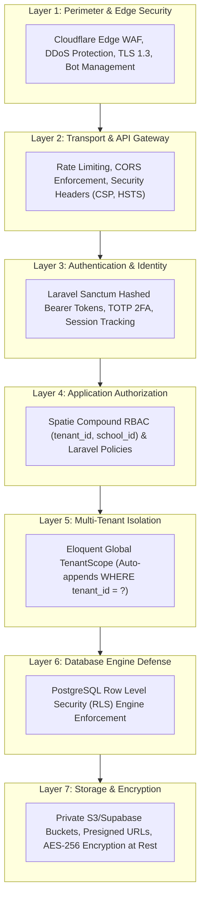

# Security Architecture & Governance Specification
## Project: Multi-Tenant School Management System (School ERP SaaS)
**Document Version:** 1.0.0  
**Compliance Targets:** FERPA (Family Educational Rights and Privacy Act), GDPR, Indian DPDP Act 2023  
**Classification:** Restricted / Technical Specification  

---

## 1. Security Philosophy: Defense-in-Depth

The School ERP SaaS is engineered with a multi-layered security model where no single protective measure is solely responsible for data confidentiality, integrity, or availability.



---

## 2. Multi-Tenant Isolation & Anti-Leakage Architecture

### 2.1 The Two-Tier Isolation Boundary
In a shared-database multi-tenant SaaS, tenant bleed is the most critical catastrophic risk. We mitigate this using two independent enforcement boundaries:

1. **Application-Level Isolation (Eloquent Global Scope):**
   - Every Eloquent model inheriting `TenantAwareModel` applies `TenantScope`.
   - Automatically injects `WHERE tenant_id = ?` into all `SELECT`, `UPDATE`, and `DELETE` queries.
   - Prevents developer oversights from leaking records.

2. **Database-Level Isolation (PostgreSQL Row Level Security):**
   - The PostgreSQL engine enforces `USING (tenant_id = current_tenant_id())` on physical disk reads.
   - Even if raw SQL (`DB::select(...)`) is executed without a `where` clause, PostgreSQL drops rows belonging to other tenants.
   - Session variable `app.current_tenant_id` is set on every request via `DB::statement("SET LOCAL app.current_tenant_id = ?", [$tenantId])`.
   - `SET LOCAL` is scoped strictly to the current database transaction/connection and automatically cleared upon connection return to the pool, preventing connection contamination.

### 2.2 Anti-Spoofing Tenant Resolution Pipeline
The application **never** trusts client-supplied identifiers:
```php
// TenantResolutionMiddleware
public function handle(Request $request, Closure $next)
{
    $user = $request->user();
    $requestedTenantId = $request->header('X-Tenant-ID');

    // 1. Verify user is authenticated
    if (!$user) {
        return response()->json(['message' => 'Unauthenticated'], 401);
    }

    // 2. Allow Platform Super Admin to impersonate with logged audit trail
    if ($user->is_platform_admin && $requestedTenantId) {
        $this->bindTenantContext($requestedTenantId, true);
        return $next($request);
    }

    // 3. Verify membership in tenant_users table
    $membership = DB::table('tenant_users')
        ->where('user_id', $user->id)
        ->where('tenant_id', $requestedTenantId)
        ->where('is_active', true)
        ->first();

    if (!$membership) {
        Log::warning("Tenant spoofing attempt detected", [
            'user_id' => $user->id,
            'ip' => $request->ip(),
            'attempted_tenant' => $requestedTenantId
        ]);
        return response()->json(['message' => 'Forbidden: Unauthorized tenant scope'], 403);
    }

    // 4. Validate branch school_id belongs to the tenant
    $requestedSchoolId = $request->header('X-School-ID');
    if ($requestedSchoolId) {
        $schoolValid = DB::table('schools')
            ->where('id', $requestedSchoolId)
            ->where('tenant_id', $requestedTenantId)
            ->where('is_active', true)
            ->exists();

        if (!$schoolValid) {
            return response()->json(['message' => 'Invalid school branch for this tenant'], 403);
        }
    }

    // 5. Establish verified session in app and database
    $this->bindTenantContext($requestedTenantId, false, $requestedSchoolId);

    return $next($request);
}
```

---

## 3. Granular Role-Based Access Control (RBAC) Matrix

Permissions follow the standard pattern: `{module}.{action}`.
Allowed actions: `view`, `create`, `edit`, `delete`, `approve`, `export`, `print`.

### 3.1 Comprehensive Role-Permission Mapping Matrix

| Role | Students | Admissions | Attendance | Fees | Exams | Timetable | Staff/HR | Library | Transport | Settings |
| :--- | :---: | :---: | :---: | :---: | :---: | :---: | :---: | :---: | :---: | :---: |
| **Platform Super Admin** | - | - | - | - | - | - | - | - | - | Full Platform |
| **School Owner** | Full | Full | Full | Full (Approve) | Full (Approve) | Full | Full | Full | Full | Full Branch |
| **School Admin** | Full | Full | Full | Full | Full | Full | Full | Full | Full | Branch Config |
| **Principal** | Full | Full | Full | View, Export | Approve, View | Full | Full | View | View | Academic Setup |
| **Vice Principal** | View, Edit | View | View, Edit | View | Edit, View | Full | View | View | View | None |
| **Accountant** | View | View | View | Full (Collect) | View | None | View (Salary) | None | View | None |
| **Admission Officer**| Create, View| Full | View | View | None | None | None | None | None | None |
| **Teacher** | View | None | Mark (Class) | None | Mark (Assigned)| View | None | View | None | None |
| **Class Teacher** | View, Edit | None | Full (Cohort)| View Dues | Tabulate | View | None | View | View | None |
| **Librarian** | View | None | None | Fine Collect | None | None | None | Full | None | None |
| **Transport Mgr** | View | None | None | Transport Fees| None | None | Driver Mgmt | None | Full | Routes/Stops |
| **HR Manager** | None | None | Staff Attd | None | None | None | Full (Payroll)| None | None | None |
| **Receptionist** | View | Inquiry Entry| None | None | None | None | None | None | None | Visitor Pass |
| **Parent** | View (Ward) | Apply | View (Ward) | Pay (Ward) | View (Ward) | View (Ward) | None | History | Live Track | None |
| **Student** | View (Self) | None | View (Self) | None | View (Self) | View (Self) | None | History | Live Track | None |
| **Driver** | None | None | None | None | None | None | None | None | Route/Pickup | None |

---

## 4. Authentication & Session Hardening

1. **Bearer Token Storage:**
   - Handled via Laravel Sanctum.
   - Tokens stored in the database hashed using `SHA-256`. Plaintext tokens are returned strictly once during authentication.
2. **Two-Factor Authentication (2FA):**
   - Mandatory for all administrative roles (`Platform Super Admin`, `School Owner`, `School Admin`, `Principal`, `Accountant`, `HR Manager`).
   - Implemented via TOTP (RFC 6238) compatible with Google Authenticator, 1Password, and Microsoft Authenticator.
   - 8 one-time cryptographic recovery codes provided upon 2FA enrollment.
3. **Session Revocation & Invalidation:**
   - Password reset automatically invalidates all existing Sanctum tokens across all devices.
   - Role modifications or user status suspension immediately revokes active tokens.
4. **Rate Limiting & Anti-Brute-Force:**
   - Login attempts throttled to 5 requests per minute per IP address.
   - On 5 consecutive failed attempts, exponential backoff locks the account for 15 minutes and dispatches a security warning email.

---

## 5. Data Privacy & Statutory Compliance

### 5.1 Student Data Privacy (FERPA & Indian DPDP Act 2023)
- **Directory Information Controls:** Parents can flag student records as "Restricted", suppressing student information from school directories, public notices, and yearbooks.
- **Data Minimization:** Sensitive health/medical information is stored in encrypted JSONB columns with restricted access grants limited to School Nurses and authorized Admins.
- **Right to Erasure / Graduation Archiving:** Graduated student records transition to an immutable archival state after statutory retention periods (7 years).

### 5.2 Secure File Storage & Document Governance
- All physical documents (Birth Certificates, Aadhaar Cards, Transfer Certificates, Staff Contracts) are stored in **private, non-public Supabase Storage buckets**.
- Direct URLs to storage objects are blocked.
- Access requires a backend-generated **Presigned URL** signed with an HMAC-SHA256 signature and a 15-minute Time-to-Live (TTL).
- File uploads are validated using file signature magic bytes (preventing malicious executables disguised as `.pdf` or `.png`).

---

## 6. Audit Logging & Non-Repudiation

1. **Immutable Audit Register:**
   - All state mutations (`create`, `update`, `delete`, `approve`, `export`) automatically persist to `audit_logs`.
   - Stored attributes: `actor_id`, `actor_email`, `tenant_id`, `school_id`, `ip_address`, `user_agent`, `action`, `auditable_type`, `auditable_id`, `old_values`, `new_values`, and `timestamp`.
2. **Export Logging:**
   - Bulk exports (Student lists, Fee ledgers, Staff directories) trigger a priority audit log recording query criteria and record count.
3. **Tamper Prevention:**
   - Database triggers deny `UPDATE` or `DELETE` statements on `audit_logs`.

