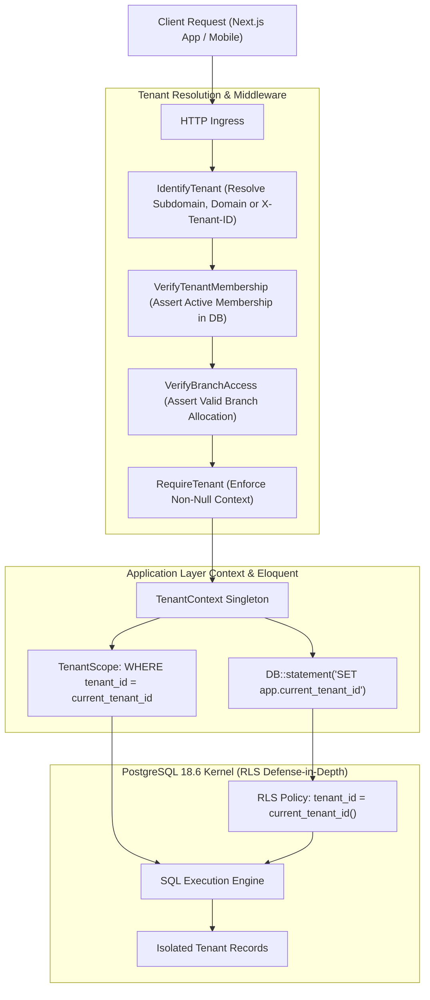
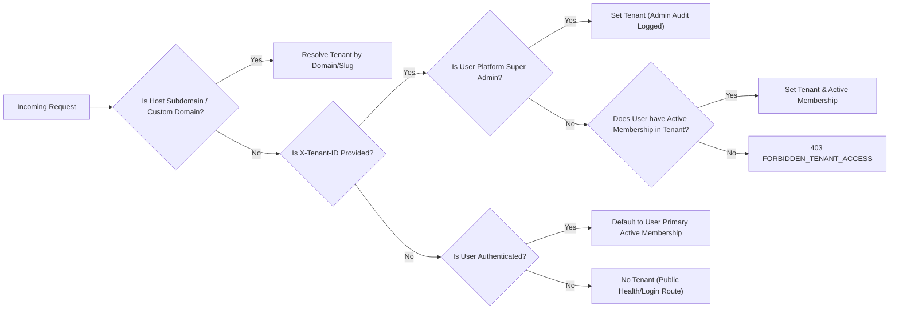

# Multi-Tenant Architecture & Security Specification
## School ERP SaaS (EduCore Platform)

---

## 1. Architectural Design & Philosophy

EduCore employs a **Shared Database, Shared Schema Multi-Tenant Architecture** built on PostgreSQL 18+ and Laravel 12. Multiple school organizations (tenants) and their campuses (branches) coexist securely within a single database instance through **Dual-Layer Defense-in-Depth**:

1. **Application Layer (Laravel Eloquent):** Automatic global query scopes (`TenantScope`, `BranchScope`) and active model lifecycle stamping (`TenantScoped`, `BranchScoped`).
2. **Database Engine Layer (PostgreSQL Row-Level Security):** Hardware-level row isolation via native PostgreSQL policies enforcing `tenant_id = current_tenant_id()`.
3. **Authorization Layer (Laravel Policies):** Fine-grained policies (`StudentPolicy`, `FeeInvoicePolicy`, `FileUploadPolicy`) enforcing role boundaries (e.g. teachers only view assigned classes; parents only view linked children; zero cross-tenant IDOR).



---

## 2. Tenant Resolution Flow & Precedence Hierarchy

Frontend requests must **never** be trusted blindly. An arbitrary `X-Tenant-ID` header supplied by an attacker is immediately rejected unless verified against the database.

### 2.1 Resolution Precedence



1. **Domain & Subdomain Resolution:**
   - Evaluates host against `tenant_domains` (where `is_verified = true`).
   - Evaluates subdomains: `{subdomain}.erp.domain.com` mapped to `tenants.slug`.
2. **Authenticated Membership Verification (`X-Tenant-ID`):**
   - If an authenticated user supplies `X-Tenant-ID`, the system queries `tenant_memberships` table where `user_id = $user->id`, `tenant_id = $headerTenantId`, and `is_active = true`.
   - If no active record exists, request is aborted with `403 FORBIDDEN_TENANT_ACCESS`.
3. **User Default Fallback:**
   - If no header or domain is present, the user's primary active membership is loaded.
4. **Platform Super Admin Exemption:**
   - Users with `is_platform_admin = true` can switch to any tenant for support or audit purposes.

---

## 3. Tenancy Middleware Pipeline

The application registers four specialized middleware components in `bootstrap/app.php`:

| Middleware | Class | Purpose | Error Code on Failure |
| :--- | :--- | :--- | :--- |
| `tenant.identify` | `App\Http\Middleware\IdentifyTenant` | Resolves tenant from request headers or host, checks suspension status, initializes `TenantContext`. | `403 TENANT_SUSPENDED` / `404 TENANT_NOT_FOUND` |
| `tenant.require` | `App\Http\Middleware\RequireTenant` | Guards tenant-specific endpoints, rejecting requests that lack a resolved tenant. | `400 TENANT_REQUIRED` |
| `tenant.membership`| `App\Http\Middleware\VerifyTenantMembership` | Verifies the authenticated user holds an active membership in the resolved tenant. | `403 FORBIDDEN_TENANT_ACCESS` |
| `branch.access` | `App\Http\Middleware\VerifyBranchAccess` | Validates `X-Branch-ID` belongs to the tenant and matches user's branch permissions. | `403 FORBIDDEN_BRANCH_ACCESS` |

---

## 4. `TenantContext` Singleton Service API

Located at `App\Services\Tenancy\TenantContext`, this service acts as the single source of truth for the active request or worker thread:

```php
// Querying Context
$tenantId = app(TenantContext::class)->getTenantId();
$tenant = app(TenantContext::class)->getTenant();
$branchId = app(TenantContext::class)->getBranchId();
$schoolId = app(TenantContext::class)->getSchoolId();
$isSuperAdmin = app(TenantContext::class)->isSuperAdmin();

// Scoped Closure Execution (Restores previous context automatically)
$result = app(TenantContext::class)->executeAsTenant($targetTenant, function () {
    return Student::count(); // Runs strictly within $targetTenant scope
}, $targetBranch);

// Administrative Scope Bypass
$allStats = app(TenantContext::class)->withoutTenancy(function () {
    return Tenant::withCount('schools')->get();
});
```

---

## 5. Eloquent Tenancy Scoping & Traits

All tenant-owned models use `App\Traits\TenantScoped`:

```php
namespace App\Models;

use App\Traits\TenantScoped;
use Illuminate\Database\Eloquent\Model;

class Student extends Model
{
    use TenantScoped;
    // ...
}
```

### 5.1 Automatic Scoping Mechanism
1. **Query Construction:** Intercepts every `SELECT`, `UPDATE`, `DELETE` and automatically appends:
   ```sql
   WHERE "students"."tenant_id" = '01a1f3cf-...'
   ```
2. **Model Creation:** Automatically stamps `tenant_id` from `TenantContext::getTenantId()` when creating records if not explicitly passed.
3. **Branch Scoping:** Branch-level tables utilize `App\Traits\BranchScoped` to additionally restrict queries by `branch_id` when active.

---

## 6. PostgreSQL Row-Level Security (RLS) Specification

Migration `2026_11_19_100014_enable_row_level_security.php` activates PostgreSQL kernel-level row filtering on sensitive tables:

```sql
-- Helper Function
CREATE OR REPLACE FUNCTION current_tenant_id() RETURNS UUID AS $$
BEGIN
    RETURN NULLIF(current_setting('app.current_tenant_id', true), '')::UUID;
EXCEPTION
    WHEN OTHERS THEN RETURN NULL;
END;
$$ LANGUAGE plpgsql STABLE;

-- RLS Enforcement
ALTER TABLE students ENABLE ROW LEVEL SECURITY;

CREATE POLICY tenant_isolation_policy ON students
    FOR ALL
    USING (
        tenant_id = current_tenant_id()
        OR current_setting('app.is_super_admin', true) = 'true'
        OR current_tenant_id() IS NULL
    )
    WITH CHECK (
        tenant_id = current_tenant_id()
        OR current_setting('app.is_super_admin', true) = 'true'
        OR current_tenant_id() IS NULL
    );
```

### RLS-Enabled Tables
1. `students`
2. `student_enrollments`
3. `guardians`
4. `fee_invoices`
5. `fee_payments`
6. `audit_logs`
7. `file_uploads`

---

## 7. Fine-Grained Authorization Policies

Policies inherit from `App\Policies\BaseTenantPolicy` to provide defense against cross-tenant IDOR and unauthorized role actions:

### 7.1 Student Access Rules (`StudentPolicy`)
- **Cross-Tenant:** If `$student->tenant_id !== $currentTenantId`, access is strictly DENIED (`false`).
- **School Admins & Principals:** Access allowed across school branch.
- **Teachers:** A teacher can view **only** students enrolled in sections or classes where the teacher is actively assigned (verified via `ClassTeacher` or `TeacherSubject`). Teachers cannot access students in other classes or unrelated schools.
- **Parents:** A parent can view **only** students linked to their user account via `StudentGuardian`. Parents cannot view other parents' children.
- **Students:** Can only view their own student profile (`$student->user_id === $user->id`).

### 7.2 Financial Access Rules (`FeeInvoicePolicy`)
- Cross-tenant invoices are completely hidden.
- Parents can view only invoices issued for their verified children.
- Accountants can view and manage invoices within their branch.

### 7.3 Document Access Rules (`FileUploadPolicy`)
- Cross-tenant file downloads are blocked with 403 Forbidden.
- Prevents file enumerations and IDOR vulnerability on sensitive student/school PDFs and contracts.

---

## 8. Queue & Background Job Tenancy Isolation

Background queue workers run continuously and can process jobs from multiple tenants. To prevent accidental cross-tenant data leakage:

All queued jobs implement `App\Jobs\Traits\TenantAwareJob`:

```php
namespace App\Jobs;

use App\Jobs\Traits\TenantAwareJob;
use Illuminate\Contracts\Queue\ShouldQueue;

class GenerateReportCardsJob implements ShouldQueue
{
    use TenantAwareJob;

    public function __construct()
    {
        $this->captureTenantContext(); // Serializes tenantId, branchId, schoolId into payload
    }

    public function handle(TenantContext $context): void
    {
        // Executes strictly inside the captured tenant scope
    }
}
```

The `ApplyTenantContext` job middleware automatically deserializes and initializes `TenantContext` before `handle()` runs and restores the previous context in a `finally` block when done.

---

## 9. Automated Isolation Test Suite

The test suite at `backend/tests/Feature/TenantIsolationTest.php` proves the following security guarantees against PostgreSQL 18.6:

| Security Assertion | Test Result | Verification Method |
| :--- | :--- | :--- |
| **School A cannot access School B students** | **PASS** | Checked via Eloquent and HTTP API endpoint (`/api/v1/students`) |
| **School A cannot access School B invoices** | **PASS** | Checked via Eloquent and HTTP API endpoint (`/api/v1/invoices`) |
| **School A cannot access School B documents** | **PASS** | Checked via `/api/v1/documents/{document}` (returns 404/403) |
| **Teacher restricted to assigned classes** | **PASS** | Gate authorization denies access to unassigned sections |
| **Parent restricted to linked children** | **PASS** | Gate authorization denies access to other parents' children |
| **User cannot switch to unauthorized tenant** | **PASS** | `X-Tenant-ID` header rejected with `403 FORBIDDEN_TENANT_ACCESS` |
| **Background jobs isolate tenant records** | **PASS** | `TestTenantJob` queries only records of captured tenant |
| **Subdomain resolution** | **PASS** | Host `oakridge.erp.local` maps to tenant `oakridge` |
| **Suspended tenant blocking** | **PASS** | Requests return `403 TENANT_SUSPENDED` with suspension reason |
| **Platform super admin support access** | **PASS** | Super admin can explicitly audit and access any tenant |
| **Context state restoration** | **PASS** | `executeAsTenant` cleanly restores previous context |

